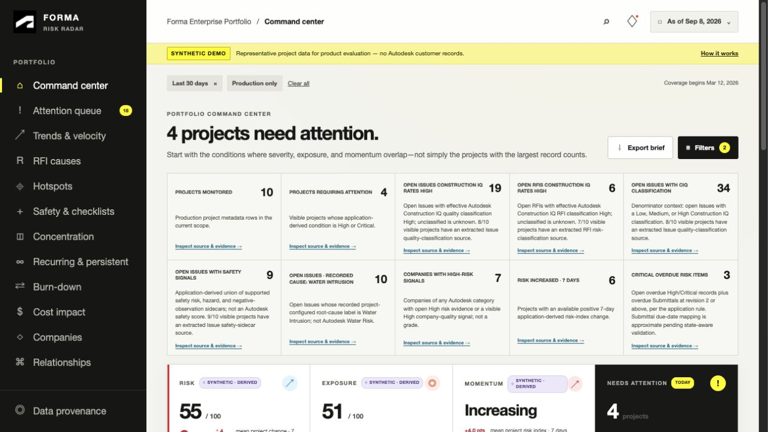

# Forma Risk Radar Demo


[](https://nodejs.org/)
[](https://nextjs.org/)
[](LICENSE)

A standalone, interactive demonstration of Forma Risk Radar: construction portfolio risk
intelligence using deterministic, fictional project data. **No Autodesk sign-in, APS
credentials, database, or environment file is required.**

Explore three separate dimensions—Risk, Exposure, and Momentum—across a synthetic portfolio
of construction projects. The dashboard keeps source-shaped values distinct from
application-derived metrics and links recommendations to supporting evidence without
claiming causality. All displayed data is clearly labelled as synthetic demo data.



## Usage

```bash
git clone https://github.com/rachermatt/forma-risk-radar-demo.git
cd forma-risk-radar-demo
npm ci
npm run dev
```

Open [http://localhost:8080](http://localhost:8080) to explore:

- Portfolio command center, indicators, filters, attention queue, and project drill-downs
- Evidence drawer, recommendations, metric definitions, provenance, and data coverage
- Trends and velocity, persistence, location hotspots, concentration, recurrence, and burn-down
- Company risk patterns, safety observations, checklist indicators, and schedule exposure
- Cost-impact evidence, RFI cause intelligence, and relationship conversion evidence

Clicks and filters operate on the synthetic dataset only. There are no Autodesk API calls or
real project updates. The dashboard stays in demo mode even if `DATA_MODE=autodesk` is set;
Autodesk authentication routes are disabled and return 404.

## Development

### Prerequisites

- Node.js 22 or newer
- npm (included with Node.js)
- Git

### Build and run

```bash
npm ci
npm run build
npm start
```

Both development and production servers default to port 8080. If that port is occupied,
use `npm run dev -- --port 8082` and open `http://localhost:8082` instead.

The production build uses Next.js's Webpack builder.

### Validation

```bash
npm run typecheck
npm test
npm run build
```

The test suite includes analytics, provenance, data coverage, and demo-only access checks.
Inherited backend libraries remain as tested reference code; they are not active runtime
services and do not need configuration or database seeding to run the demo.

### Deployment and limitations

Deploy to a Node.js/Next.js-compatible host using the build and start commands above.
Optionally set `APP_ORIGIN` to the deployed HTTPS origin for social metadata. Do not
configure Autodesk credentials or database access for this edition.

Publishing this repository does not automatically host a live website. The app uses a Next.js
server and nonce-based security headers; it is not configured as a static GitHub Pages site.
This repository does not connect to a live Autodesk hub, ingest extracts, or perform write-back.

### Documentation

- [Demo setup](docs/setup.md) — installation, deployment, verification, and troubleshooting
- [Risk definition catalog](docs/risk-definition-catalog.md) — formulas and interpretation
- [Risk relationships](docs/risk-relationships.md) — relationship confidence and evidence
- [Architecture](docs/architecture.md) — demo runtime and inherited backend reference design
- [Security](docs/security.md) — demo boundaries and original backend security reference
- [Autodesk data map](docs/autodesk-data-map.md) — upstream source mapping reference
- [Feasibility assessment](docs/feasibility-assessment.md) — upstream scope and constraints

Based on the [Forma Risk Radar sample](https://github.com/autodesk-platform-services/forma-risk-radar).

## License

This sample is licensed under the terms of the [MIT License](LICENSE).

Autodesk, Autodesk Forma, and Autodesk Platform Services are trademarks of Autodesk, Inc.
