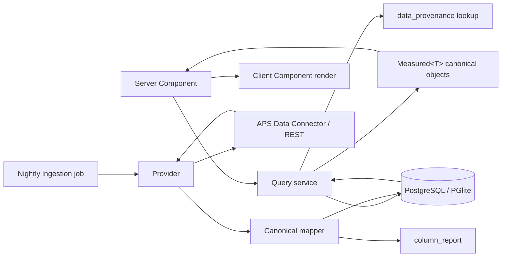

# Forma Risk Radar — Architecture

> **Demo-only edition:** The running app always renders the synthetic in-memory dataset. Its
> health/readiness endpoints do not use a database, and Autodesk OAuth routes are not registered.
> Provider, persistence, and authentication libraries below are retained as tested upstream
> reference code, not an active ingestion or sign-in path. See [Demo setup](setup.md).

Status: target architecture plus a partially implemented V1 foundation.

> **Current implementation boundary (2026-09-10).** The synthetic dashboard, canonical types,
> deterministic analytics, provider/security contracts, executable database schema, immutable
> migration plan, and demo seeder exist. Live extract ZIP/CSV mapping, ingestion orchestration, and
> database-backed dashboard reads do not. In Autodesk mode the page fails closed at an activation
> gate. Treat [`src/lib/db/schema.sql`](../src/lib/db/schema.sql) plus
> [`src/lib/db/migration-plan.ts`](../src/lib/db/migration-plan.ts) as authoritative for executable
> storage; the expanded SQL later in this document is a target data model, not runnable migration
> input.

---

## 0. Naming, and what this system talks to

Autodesk renamed **Autodesk Construction Cloud to "Forma"** effective **2026-03-24**. The API
reference set is now *titled* "Forma APIs" and lives at `/en/docs/acc/v1/`, while every base path
is unchanged: `/construction/…`, `/cost/v1/…`, `/bim360/…`, `/data-connector/v1/…`.

This is **not** Forma Site Design (ex-Spacemaker) at `/en/docs/forma/v1/`. That product has no
Issues, RFIs, Submittals, Forms, Construction IQ or Data Connector and is entirely out of scope.
A bare-GUID hub id identifies ACC-now-Forma; Forma Site Design uses `pro_…` ids.

Configure an ACC/Forma hub as the bare account GUID `<ACC_ACCOUNT_ID>`. Data Management addresses
the same account as `b.<ACC_ACCOUNT_ID>`.

Throughout this document three labels are used and they are load-bearing:

| Label | Meaning |
|---|---|
| **[DOC]** | Documented behaviour of an Autodesk API or dataset. |
| **[VALIDATE]** | Source shape, availability or runtime behaviour that must pass an activation probe before use; not a platform guarantee. |
| **[OURS]** | Computed by Forma Risk Radar. Never attributable to Autodesk. |

The product is a **daily risk intelligence system, not a real-time feed**. That is forced, not
chosen: Construction IQ is reachable only through Data Connector batch extracts [DOC], and a hub is
hard-capped at **24 Data Connector jobs per rolling 24 hours** [DOC].

---

## 1. System overview

```
                          ┌─────────────────────────────────────────────┐
                          │  Autodesk Platform Services (Forma / ACC)   │
                          │                                             │
   3-legged OAuth ───────▶│  /data-connector/v1/accounts/{accountId}    │  batch, account-wide,
	   (Data Connector        │      runtime-discovered extract schema     │  only path to iq_*
    3LO path [VALIDATE])  │  /construction/admin|issues|rfis|           │
                          │      submittals|forms|locations             │  per-project REST
                          │  /cost/v1/containers/{containerId}          │
                          │  /bim360/relationship/v2  /modelset/v3      │
                          │  /webhooks/v1  (issues, reviews, cost, dm)  │
                          └────────────────────┬────────────────────────┘
                                               │  server-side only. No browser
                                               │  code ever holds an APS token.
┌──────────────────────────────────────────────▼──────────────────────────────────────────────┐
│  PROVIDER ABSTRACTION LAYER            src/lib/providers/**                                  │
│                                                                                              │
│  ApsAuthProvider  DataConnectorProvider  IssuesProvider  RfiProvider  FormsProvider           │
│  ReviewsProvider  SubmittalsProvider     ScheduleProvider                                    │
│                                                                                              │
│  Two implementations per interface:  autodesk/*   and   demo/*   (DATA_MODE switch)          │
│  Sole responsibility: Autodesk wire shape  ──▶  canonical types  (src/lib/canonical/types.ts)│
└──────────────────────────────────────────────┬───────────────────────────────────────────────┘
                                               │  canonical types ONLY past this line
┌──────────────────────────────────────────────▼──────────────────────────────────────────────┐
│  INGESTION [TARGET] + DB FOUNDATION     mapper/orchestrator pending · src/lib/db/**          │
│                                                                                              │
│  Target: snapshot → diff → UPSERT → immutable history. Current: schema, migrations, demo seed.│
│  PostgreSQL.  Default engine: PGlite (@electric-sql/pglite), real Postgres compiled to WASM, │
│  in-process, no server, no Docker.  DATABASE_URL switches to a Postgres server. Same schema, │
│  same SQL.                                                                                    │
└──────────────────────────────────────────────┬───────────────────────────────────────────────┘
                                               │
┌──────────────────────────────────────────────▼──────────────────────────────────────────────┐
│  RISK ENGINE                            src/lib/risk/**                                      │
│                                                                                              │
│  RiskNormalizationService   RiskRelationshipService   RiskRecurrenceService                  │
│  RiskExposureService        HistoricalSnapshotService MitigationService                      │
│                                                                                              │
│  Every output carries MetricProvenance{ definitionId, definitionVersion, valueKind, … }      │
│  Every derived calculation writes a data_provenance row: inputs, algorithm version, result.  │
└──────────────────────────────────────────────┬───────────────────────────────────────────────┘
                                               │  Measured<T> only
┌──────────────────────────────────────────────▼──────────────────────────────────────────────┐
│  UI  —  Next.js 16 App Router, React 19, TypeScript                                          │
│                                                                                              │
│  Server Components + Route Handlers do all APS and all SQL.                                  │
│  Client Components receive plain serialised canonical objects. No component imports a        │
│  provider, an Autodesk type, or a SQL client.                                                │
│                                                                                              │
│  Portfolio Command Center · Attention Queue · Project Detail · Trends · Hotspots ·           │
│  Concentration · Burn-Down · Subcontractor Risk · Conversion Funnel · Record Drawer ·        │
│  Provenance                                                                                  │
└──────────────────────────────────────────────────────────────────────────────────────────────┘
```

Target live request flow (not yet wired to the page):



The target asymmetry is intentional: **the future live read path will never call Autodesk during a
page render.** Today, demo rendering consumes the deterministic in-memory generator; Autodesk mode
renders only the activation gate. The persistence query service and live mapper/orchestrator remain
implementation work.

---

## 2. The provider abstraction layer, and why it exists

### 2.1 Why

Three independent forces make direct Autodesk calls from feature code unacceptable:

1. **Autodesk changes these APIs.** The doc set was renamed mid-flight (ACC → Forma). RFI
   `discipline` is published with **three mutually inconsistent enum lists across three reference
   pages** [DOC]. The Data Connector CDC service groups are **beta** [DOC]. `cdciq` has a published
   schema but is **absent from the documented delta `serviceGroups` enum** [DOC]. Anything that
   compiles against a wire shape will break.
2. **The same fact arrives through different doors with different shapes.** Issue status has
   **13 values in the Data Connector `issues_issues` dataset against 9 in the REST API** [DOC] —
   union them naively and the aggregate is wrong. RFI cost impact exists both as a REST tri-state
   field; validate the corresponding `cost_impact` column on the DC `rfis` dataset at activation
   [DOC, VALIDATE].
3. **Demo mode must be indistinguishable to everything above the boundary.** `DATA_MODE=demo` runs
   with no Autodesk credentials at all; every provider has a `demo/` implementation returning
   synthetic canonical objects labelled `sourceSystem: "demo-generator"`.

### 2.2 The interfaces

All live under `src/lib/providers/`. Each has exactly two implementations, selected once at
composition root by `DATA_MODE`.

| Provider | Responsibility | Primary Autodesk surface |
|---|---|---|
| `ApsAuthProvider` | Token acquisition, refresh, region resolution, per-hub custom-integration status caching | APS OAuth; region probe (see §5.2, step 2) |
| `DataConnectorProvider` | Create requests, poll jobs, enumerate `data-listing`, fetch signed URLs within 60 s, unzip, stream CSV rows | `/data-connector/v1/accounts/{accountId}` |
| `IssuesProvider` | Issues, types/subtypes, root causes, custom attribute definitions + mappings | `/construction/issues/v1`, DC `issues` group |
| `RfiProvider` | RFIs, types, workflow, transitions | `POST /construction/rfis/v3/projects/:projectId/search:rfis`, DC `rfis` group |
| `FormsProvider` | Forms, templates, layouts, sections, values; the `fieldId → label/modifier` dictionary | Forms v1 templates + v2 forms, DC `forms` group |
| `ReviewsProvider` | Review workflows, reviews, steps, tasks, documents | DC `reviews` group; Reviews webhooks |
| `SubmittalsProvider` | Items, revisions, steps, tasks, specs, packages, metadata, responses | `/construction/submittals/v2`, DC `submittalsacc` group |
| `ScheduleProvider` | Activities, dependencies, activity codes, resources, workplan tables | **DC `schedule` group only** — there is no ACC/Forma Schedule REST API [DOC] |

`ScheduleProvider` deserves a note. No ACC/Forma Schedule REST API is documented [DOC]. Validate
the supported schedule surface during activation rather than inferring capability from a guessed
route [VALIDATE]. The provider interface therefore exposes no `refresh()` — a caller cannot ask
for fresher schedule data than the last extract, and the type system says so.

### 2.3 Contract rules

- A provider returns canonical types. It never returns `unknown`, `any`, or an Autodesk DTO.
- A provider is the **only** place an Autodesk field name may appear as a string literal.
- A provider never computes a risk value. Mapping `iq_issues_quality_risks.risk = "high"` to
  `Severity.high` is mapping. Deciding a project is "critical" is the risk engine's job.
- A provider that cannot see data must say so structurally, not by returning an empty array.
  Every module silently under-reports rather than erroring when the service identity lacks
  permission [DOC]; see §5.6.
- Providers write a `column_report` row for every extract column they see and do not map.

### 2.4 Services

Services consume providers and the database, never the network directly.

| Service | Owns |
|---|---|
| `RiskNormalizationService` | Cross-project normalisation: issue status (13-value DC set vs 9-value REST set), LBS depth→tier heuristics, trade string splitting, CIQ casing, RFI discipline reconciliation, the explicit `unmapped` bucket |
| `RiskRelationshipService` | Reading `relationships_entity_relationship`, the `clashes_assigned_clash_group.issue_id` bridge, and inferred adjacency; assigning `RelationshipConfidence` and `RelationshipMethod` |
| `RiskRecurrenceService` | Signature construction and grouping; recurrence rate |
| `RiskExposureService` | `ExposureDimension` computation across locations, companies, projects, cost and schedule linkage |
| `HistoricalSnapshotService` | Writing immutable daily rows; forward-fill of the sparse CIQ daily tables; momentum/velocity/acceleration |
| `MitigationService` | Deterministic rule evaluation always; optional AI layer behind `AI_RECOMMENDATIONS_ENABLED` |

---

## 3. The canonical model boundary rule

> **No UI component ever touches an Autodesk response shape.**

Concretely, and enforceable in review:

1. `src/lib/canonical/types.ts` is the only vocabulary above the provider layer. Nothing in
   `src/app/**` or `src/components/**` may import from `src/lib/providers/**`.
2. Every number a user can see is a `Measured<T>` — a value plus `MetricProvenance`. There is no
   path to the screen for a bare number.
3. `MetricProvenance.valueKind` is `"autodesk-provided" | "application-derived" | "ai-generated"`.
   The metric renderer refuses to render an Autodesk attribution chip unless `valueKind` is
   `"autodesk-provided"` **and** `autodeskTerm` is present.
4. `autodeskTerm` holds Autodesk's own wording verbatim and only for Autodesk-computed values.
   *"Construction IQ Quality Risk"* is an Autodesk term. *"Derived Risk Exposure Index"* is ours.
   There is no code path that can put an `autodeskTerm` on an `application-derived` value; the
   comment in `types.ts` — *"Never invent one for a derived metric"* — is backed by a type guard in
   the metric renderer and a unit test.
5. `RiskRecord.raw` retains the untouched source row so drill-down and the Provenance view can show
   it. `raw` is typed `Readonly<Record<string, unknown>>` deliberately: it can be displayed as a
   key/value table, it cannot be indexed by a feature component to sneak an unmapped field into a
   calculation.
6. Severity mapping is centralised in `severityFromConstructionIq()`. It maps `high|medium|low` and
   returns `"none"` otherwise. It can never return `"critical"` — `critical` is reserved for
   application-derived escalation and is always labelled as such.

### 3.1 Absence is not zero

Construction IQ produces **no data at all** for non-English project data, or for project types
outside Commercial / Healthcare / Institutional / Residential / Infrastructure→Transportation
Building [DOC]. Documented CIQ tables may still be absent or empty for a configured account.

`Project.availableDomains` therefore exists on the canonical `Project`. A domain absent from that
list renders **"Not Applicable"** with an explanation. It never renders as `0`, "low risk", or a
green tile. This is a correctness requirement, not a UX nicety: a permission gap and a genuine
absence of risk are indistinguishable at the wire level [DOC].

---

## 4. PostgreSQL logical schema

### 4.1 Engine

PostgreSQL. By default the app runs on **PGlite** (`@electric-sql/pglite`) — real PostgreSQL
compiled to WebAssembly, running in-process against `PGLITE_DIR` (default `.data/pg`). No server,
no Docker, no container runtime. Setting `DATABASE_URL` switches to a PostgreSQL server; the schema
and every application query are byte-identical. On external PostgreSQL, the web runtime is a
verification-only migration consumer: it checks the complete immutable migration ledger at startup
and issues no DDL. A separate deployment step runs `npm run db:migrate` with
`MIGRATION_DATABASE_URL` and a DDL-capable role before the web process starts. PGlite retains local
automatic migration because it is an embedded, single-process development database.

The shared PostgreSQL driver permits plaintext only on loopback. Every non-loopback hostname uses
certificate-verified TLS and requests channel binding when offered. All connection-string query
parameters and fragments are rejected so node-postgres cannot replace URL authority or the
application-owned TLS and timeout policy.

Verified available on PGlite and required by the risk model:

| Feature | Used by |
|---|---|
| Window functions (`lag`, `lead`, `row_number`, `sum() over`) | momentum, velocity, acceleration, burn-down cumulative curves |
| `generate_series` | dense calendar spine for forward-filling the sparse CIQ daily tables |
| Recursive CTEs | `locations` tree materialisation and subtree rollup |
| `jsonb` | `raw` payloads, rule inputs, algorithm input capture, warnings arrays |
| `percentile_cont` | exposure and attention-score percentile banding; characterising `iq_rfis_high_risk.score` |

Deliberate portability constraints:

- No extensions. `uuid-ossp`, `pg_trgm`, PostGIS are unavailable — assume none.
- Primary keys are `text` and generated in application code (ULID-style, sortable). This avoids any
  dependence on `gen_random_uuid()` availability differences and keeps natural keys legible.
- Timestamps are `timestamptz`; the process runs in UTC. `date` is used for snapshot days.
- Single writer. PGlite is in-process and effectively single-connection; the ingestion pipeline is
  serialised by design (§5) and never assumes connection pooling. External PostgreSQL uses bounded
  pools and non-zero acquisition, server statement, client query, lock, idle, and connection-lifetime
  limits. Migration timeouts are longer but remain finite.

Conventions used below:

- `hub_id`, `project_id`, `company_id`, `user_id` carry Autodesk's **bare GUIDs**, never the
  `b.`-prefixed Data Management form.
- Every table sourced from Autodesk carries `source_extracted_at` (when Autodesk produced the data)
  distinct from `ingested_at` (when we wrote it).
- Every derived table carries `algorithm_version` and `calculated_at`.
- `value_kind` columns are constrained to the three `ValueKind` literals.

### 4.2 Dimensions

> **Target-model reference only.** The SQL blocks from §4.2 onward preserve the researched target
> shape and intentionally include columns not yet in the executable V1. Do not paste them into a
> database. The current schema and ordered upgrades live only in `src/lib/db/schema.sql` and
> `src/lib/db/migration-plan.ts`. Among other enforced V1 details, source-record identities and Form
> identities are project-scoped, unknown CIQ/RFI enums have an explicit `unmapped` state, Issue/RFI
> source sidecars preserve model/effective/override values, relationship and recommendation history
> is algorithm-versioned, business units are keyed within a hub, and live provenance/history tables
> have append-only guards. When this target prose disagrees with those files, the executable files
> win.

```sql
-- ---------------------------------------------------------------------------
-- hubs
-- One row per Autodesk account (hub). Bare GUID, no "b." prefix.
-- ---------------------------------------------------------------------------
CREATE TABLE hubs (
  id                    text PRIMARY KEY,              -- admin_accounts.bim360_account_id
  name                  text NOT NULL,                 -- admin_accounts.display_name
  region                text,                          -- resolved by probe; NOT from the extract
  start_date            date,                          -- admin_accounts.start_date
  end_date              date,                          -- admin_accounts.end_date
  -- Services the account has, from admin_account_services.service.
  account_services      jsonb NOT NULL DEFAULT '[]'::jsonb,
  -- TRUE only after the deployment activation probe succeeds. There is no API to check Custom
  -- Integration activation. [VALIDATE]
  integration_verified  boolean NOT NULL DEFAULT false,
  data_mode             text NOT NULL CHECK (data_mode IN ('demo','autodesk')),
  source_extracted_at   timestamptz,
  ingested_at           timestamptz NOT NULL DEFAULT now()
);

-- ---------------------------------------------------------------------------
-- projects
-- Source: admin_projects. Dataset cardinality is deployment-dependent. [VALIDATE]
-- ---------------------------------------------------------------------------
CREATE TABLE projects (
  id                    text PRIMARY KEY,              -- admin_projects.id
  hub_id                text NOT NULL REFERENCES hubs(id),
  name                  text NOT NULL,
  status                text,                          -- admin_projects.status
  status_reason         text,
  type                  text,                          -- free text. "Any value is accepted." [DOC]
  classification        text,                          -- admin_projects.classification
  acc_project           boolean,                       -- admin_projects.acc_project
  business_unit_id      text,                          -- admin_projects.business_unit_id
  job_number            text,
  start_date            date,
  end_date              date,
  city                  text,
  state_or_province     text,
  country               text,
  timezone              text,
  latitude              double precision,
  longitude             double precision,
  construction_type     text,
  contract_type         text,
  value                 numeric(18,2),                 -- admin_projects.value
  currency              text,                          -- NO FX conversion is performed anywhere
  total_member_size     integer,
  total_company_size    integer,
  last_sign_in          timestamptz,
  created_at            timestamptz,
  updated_at            timestamptz,                   -- moves on project-field edits only [DOC]

  -- [OURS] --------------------------------------------------------------
  -- TRUE when the ingesting identity actually returned data for this project.
  -- FALSE is NOT "no risk"; it is "we could not see it".
  accessible            boolean NOT NULL DEFAULT false,
  -- [OURS] Non-production projects include template, training, demonstration,
  -- component, and sample classifications. Portfolio views exclude them by default.
  is_production         boolean NOT NULL DEFAULT true,
  production_exclusion_reason text,
  -- [OURS] Which RiskDomain values have any data for this project. Drives the
  -- "Not Applicable" rendering rule (§3.1).
  available_domains     jsonb NOT NULL DEFAULT '[]'::jsonb,
  -- [OURS] TRUE only when iq_project_daily_quality_risk_changes has >=1 row for
  -- this project. Absence renders Not Applicable, never "low risk".
  ciq_eligible          boolean NOT NULL DEFAULT false,

  source_extracted_at   timestamptz,
  ingested_at           timestamptz NOT NULL DEFAULT now()
);
CREATE INDEX projects_hub_idx        ON projects (hub_id) WHERE is_production;
CREATE INDEX projects_bu_idx         ON projects (business_unit_id);
CREATE INDEX projects_type_idx       ON projects (type);

-- ---------------------------------------------------------------------------
-- companies
-- Source: admin_companies. Dataset cardinality and trade coverage are deployment-dependent.
-- [VALIDATE]
-- ---------------------------------------------------------------------------
CREATE TABLE companies (
  id                    text PRIMARY KEY,              -- admin_companies.id
  hub_id                text NOT NULL REFERENCES hubs(id),
  name                  text NOT NULL,                 -- deleted companies get "removed at MMDDYYYY" [DOC]
  -- Free-form display string, max 255. Delimiter conventions are not a coded taxonomy
  -- and must be validated before normalization. [VALIDATE]
  trade                 text,
  -- [OURS] trade split on " | ". NULL when trade is NULL or has no delimiter.
  trade_primary         text,
  trade_secondary       text,
  category              text,                          -- admin_companies.category
  status                text,
  erp_id                text,
  tax_id                text,
  city                  text,
  state_or_province     text,
  country               text,
  website_url           text,
  project_size          integer,
  user_size             integer,
  custom_properties     jsonb,
  created_at            timestamptz,
  source_extracted_at   timestamptz,
  ingested_at           timestamptz NOT NULL DEFAULT now()
);
CREATE INDEX companies_trade_idx ON companies (trade_primary);

-- ---------------------------------------------------------------------------
-- users
-- Source: admin_users + admin_project_users + admin_project_user_companies.
-- The Issues API has no user directory: "you can only check permissions for the
-- 'current' user" [DOC]. assignee_id is opaque without this table.
-- ---------------------------------------------------------------------------
CREATE TABLE users (
  id                    text PRIMARY KEY,              -- admin_users.id
  hub_id                text NOT NULL REFERENCES hubs(id),
  autodesk_id           text,                          -- admin_users.autodesk_id (oxygen id)
  email                 text,
  name                  text,
  first_name            text,
  last_name             text,
  job_title             text,
  default_company_id    text REFERENCES companies(id),
  default_role_id       text,
  status                text,
  access_level_account_admin   boolean,
  access_level_project_admin   boolean,
  access_level_project_member  boolean,
  access_level_executive       boolean,
  last_sign_in          timestamptz,
  created_at            timestamptz,
  updated_at            timestamptz,
  source_extracted_at   timestamptz,
  ingested_at           timestamptz NOT NULL DEFAULT now()
);
CREATE INDEX users_autodesk_idx ON users (autodesk_id);

-- Project membership, and the ONLY reliable route from a record's assignee to a
-- company (and thence to a trade). A project user has exactly one company. [DOC]
CREATE TABLE project_users (
  project_id            text NOT NULL REFERENCES projects(id),
  user_id               text NOT NULL REFERENCES users(id),
  company_id            text REFERENCES companies(id),  -- nullable; explicitly so [DOC]
  access_level          text,
  status                text,
  created_at            timestamptz,
  updated_at            timestamptz,
  source_extracted_at   timestamptz,
  ingested_at           timestamptz NOT NULL DEFAULT now(),
  PRIMARY KEY (project_id, user_id)
);

-- Role names cannot be resolved through REST: "We do not currently provide endpoints
-- to programmatically retrieve information about roles." [DOC] Data Connector
-- admin_project_roles / admin_roles is the extract-side catalogue; validate availability at ingest.
-- Join on role key/id, never on localised display name. [DOC]
CREATE TABLE roles (
  id                    text PRIMARY KEY,              -- admin_roles.id / admin_project_roles.role_id
  hub_id                text NOT NULL REFERENCES hubs(id),
  project_id            text REFERENCES projects(id),  -- NULL for account-level roles
  role_oxygen_id        text,
  name                  text,
  status                text,
  source_extracted_at   timestamptz,
  ingested_at           timestamptz NOT NULL DEFAULT now()
);

-- ---------------------------------------------------------------------------
-- locations
-- Source: locations_trees + locations_nodes. Dataset cardinality is deployment-dependent.
-- Validate at activation whether locations_nodes exposes a `type` column. [VALIDATE] The REST node `type`
-- enum is Root|Area|Level and "only Area is a currently supported request value";
-- "the nodes in a given tier don't all have to represent the same type of
-- location". [DOC] Building/Level/Zone/Room semantics are therefore OURS.
-- Node deletes cascade and unlink referenced objects with no tombstone [DOC] —
-- rows here are NEVER hard-deleted so historical location_id stays renderable.
-- ---------------------------------------------------------------------------
CREATE TABLE locations (
  id                    text PRIMARY KEY,              -- locations_nodes.id
  project_id            text NOT NULL REFERENCES projects(id),
  tree_id               text NOT NULL,                 -- locations_nodes.tree_id ("default" via REST)
  parent_id             text REFERENCES locations(id),
  name                  text NOT NULL,                 -- free text, for example "Building A" or "Level 1"
  sort_order            integer,                       -- locations_nodes.order
  -- [OURS] depth from root, 1-based (the tree root node is depth 1).
  -- Profile maximum depth and labels per project before deriving tiers.
  depth                 integer NOT NULL,
  -- [OURS] materialised "Project > WEST > Level 1" path, recomputed each snapshot.
  path                  text NOT NULL,
  -- [OURS] normalised tier from depth + regex. NEVER presented as Autodesk data.
  derived_tier          text CHECK (derived_tier IN
                          ('building','level','zone','room','unmapped')),
  derived_tier_rule     text,                          -- which heuristic fired, for the Provenance view
  -- Tombstone. Set when a node disappears from an extract; the row survives.
  deleted_observed_at   timestamptz,
  created_at            timestamptz,                   -- validate DC presence; absent from REST [DOC, VALIDATE]
  updated_at            timestamptz,
  source_extracted_at   timestamptz,
  ingested_at           timestamptz NOT NULL DEFAULT now()
);
CREATE INDEX locations_project_idx ON locations (project_id);
CREATE INDEX locations_parent_idx  ON locations (parent_id);
```

### 4.3 Source records

`source_records` is the canonical flat projection every domain-agnostic analytic reads
(`RiskRecord` in `types.ts`). The per-module tables retain everything the projection drops.

```sql
-- ---------------------------------------------------------------------------
-- source_records  — canonical RiskRecord. One row per issue/rfi/submittal/form/
-- review/clash-group/change-order/schedule-activity that can carry risk.
-- ---------------------------------------------------------------------------
CREATE TABLE source_records (
  kind                  text NOT NULL CHECK (kind IN
                          ('issue','rfi','submittal','form','review',
                           'clash-group','change-order','schedule-activity')),
  id                    text NOT NULL,                 -- Autodesk's record id
  project_id            text NOT NULL REFERENCES projects(id),
  display_id            text,
  title                 text NOT NULL,
  status                text NOT NULL,                 -- raw Autodesk status, unmodified
  status_normalized     text NOT NULL,                 -- [OURS] see §7.2
  open                  boolean NOT NULL,              -- [OURS] derived from status_normalized

  domain                text NOT NULL CHECK (domain IN
                          ('design','rfi','quality','safety','subcontractor',
                           'submittal','coordination','cost','schedule')),

  -- Construction IQ classification. [DOC, VALIDATE] Autodesk-provided; sidecar tables only.
  -- NOTE: there is no 'critical' Construction IQ value. Quality risk is documented
  -- Quality and cost-impact fields can use different casing; preserve raw source
  -- values and map them explicitly. 'critical' is reserved for
  -- application-derived escalation (§3, rule 6) and may never appear in these columns.
  ciq_risk              text NOT NULL DEFAULT 'none'
                          CHECK (ciq_risk IN ('high','medium','low','none')),
  ciq_risk_user_override boolean NOT NULL DEFAULT false, -- a user_* column disagreed
  ciq_cost_impact       text NOT NULL DEFAULT 'none'
                          CHECK (ciq_cost_impact IN ('high','medium','low','none')),
  ciq_root_cause        text,                          -- iq_*_root_cause.root_cause
  ciq_predicted_at      timestamptz,                   -- current prediction only; no version history [DOC]

  type_name             text,
  subtype_name          text,
  root_cause_id         text,                          -- issues_issues.root_cause_id; project-scoped
  root_cause            text,                          -- issues_root_causes.title
  root_cause_category   text,                          -- issues_root_cause_categories.root_cause_category
  discipline            text,
  discipline_origin     text CHECK (discipline_origin IN
                          ('operational','construction-iq','unmapped')),
  building_component    text,

  location_id           text,                          -- soft FK; node may be deleted [DOC]
  location_path         text,                          -- resolved at ingest, retained after node delete
  company_id            text REFERENCES companies(id),
  company_attribution   text NOT NULL CHECK (company_attribution IN
                          ('direct','via-assignee-membership','via-owner-membership','unattributed')),
  assignee_id           text,
  assignee_type         text CHECK (assignee_type IN ('user','company','role')),
  owner_id              text,

  created_at            timestamptz NOT NULL,
  updated_at            timestamptz,
  due_date              timestamptz,
  closed_at             timestamptz,
  responded_at          timestamptz,

  -- Autodesk source-of-record tri-states (RFIs). NOT Construction IQ. [DOC, VALIDATE]
  cost_impact           text CHECK (cost_impact IN ('yes','no','unknown')),
  schedule_impact       text CHECK (schedule_impact IN ('yes','no','unknown')),

  href                  text,
  raw                   jsonb NOT NULL,                -- untouched source row
  -- [OURS] stable hash of the mapped payload; drives no-op suppression on re-ingest.
  fingerprint           text NOT NULL,
  first_seen_at         timestamptz NOT NULL,
  last_seen_at          timestamptz NOT NULL,
  source_extracted_at   timestamptz,
  ingested_at           timestamptz NOT NULL DEFAULT now(),
  PRIMARY KEY (kind, id)
);
CREATE INDEX source_records_project_idx  ON source_records (project_id, kind);
CREATE INDEX source_records_open_idx     ON source_records (project_id, open, domain);
CREATE INDEX source_records_company_idx  ON source_records (company_id);
CREATE INDEX source_records_location_idx ON source_records (location_id);
CREATE INDEX source_records_created_idx  ON source_records (created_at);
CREATE INDEX source_records_ciq_idx      ON source_records (ciq_risk) WHERE ciq_risk <> 'none';

-- ---------------------------------------------------------------------------
-- issues  — source: issues_issues. PK column is `issue_id`, NOT `id`.
-- Validate sidecar join keys against the current extract schema before ingest.
-- There is NO severity/priority/risk column on an issue. High-risk
-- classification comes only from the iq_* sidecars.
-- ---------------------------------------------------------------------------
CREATE TABLE issues (
  issue_id              text PRIMARY KEY,              -- issues_issues.issue_id
  project_id            text NOT NULL REFERENCES projects(id),
  display_id            text,
  title                 text,
  description           text,
  type_id               text,
  subtype_id            text,
  -- Profile status literals at ingest; the DC and REST documentation publish
  -- different value sets. [DOC]
  status                text,
  assignee_id           text,
  -- Assignment can be absent; preserve NULL and disclose assignment coverage.
  assignee_type         text,
  due_date              timestamptz,
  start_date            timestamptz,
  location_id           text,
  location_details      text,
  linked_document_urn   text,
  snapshot_urn          text,
  gps_coordinates       text,
  owner_id              text,
  root_cause_id         text,
  root_cause_category_id text,
  response              text,
  response_by           text,
  response_at           timestamptz,
  opened_by             text,
  opened_at             timestamptz,
  closed_by             text,
  closed_at             timestamptz,
  created_by            text,
  created_at            timestamptz,
  updated_by            text,
  updated_at            timestamptz,
  deleted_by            text,
  deleted_at            timestamptz,                   -- filter[deleted] is mutually exclusive [DOC]
  published             boolean,
  -- Construction IQ sidecars, denormalised at ingest for query cost. All Autodesk-provided.
  iq_quality_risk       text,   -- iq_issues_quality_risks.risk
  iq_quality_user_risk  text,   -- optional human override; preserve NULL
  iq_cost_impact        text,   -- iq_cost_impact_issues.cost_impact
  iq_inspection_risk    boolean,-- iq_inspection_risk_issues.inspection_risk
  iq_safety_risk_category text, -- iq_issues_safety_risk.safety_risk_category
  iq_safety_hazard_category text,
  iq_safety_observation_category text,
  iq_design_root_cause  text,
  iq_design_building_component text,
  iq_predicted_at       timestamptz,
  fingerprint           text NOT NULL,
  source_extracted_at   timestamptz,
  ingested_at           timestamptz NOT NULL DEFAULT now()
);
CREATE INDEX issues_project_idx ON issues (project_id, status);

-- ---------------------------------------------------------------------------
-- rfis  — source: rfis_rfis.
-- Validate native cost_impact / schedule_impact / priority columns at activation.
-- When present, they are Autodesk source-of-record, NOT Construction IQ. [VALIDATE]
-- ---------------------------------------------------------------------------
CREATE TABLE rfis (
  id                    text PRIMARY KEY,              -- rfis_rfis.id
  project_id            text NOT NULL REFERENCES projects(id),
  custom_identifier     text,
  title                 text,
  question              text,
  status                text,
  priority              text,                          -- preserve source value
  cost_impact           text,                          -- Yes | No | Unknown | NULL [DOC, VALIDATE]
  schedule_impact       text,                          -- Yes | No | Unknown | NULL [VALIDATE]
  due_date              timestamptz,
  location_id           text,
  rfi_type              text,
  manager_id            text,
  linked_document       text,
  linked_document_version text,
  linked_document_close_version text,
  official_response     text,
  official_response_status text,
  suggested_answer      text,
  reference             text,
  bridged_source        text,
  bridged_target        text,
  opened_at             timestamptz,
  responded_at          timestamptz,
  responded_by          text,
  answered_at           timestamptz,
  answered_by           text,
  closed_at             timestamptz,
  closed_by             text,
  created_by            text,
  created_at            timestamptz,
  updated_by            text,
  updated_at            timestamptz,
  -- Construction IQ sidecars.
  iq_risk               text,      -- iq_rfis_high_risk.risk
  -- iq_rfis_high_risk.score is not documented as a probability or percentage.
  -- Preserve the raw ordinal; validate its range at ingest. [DOC]
  iq_risk_score         numeric(12,6),
  iq_root_cause         text,      -- preserve source value; map unknowns explicitly
  iq_discipline         text,      -- preserve source value; map unknowns explicitly
  iq_building_component text,
  iq_predicted_at       timestamptz,
  fingerprint           text NOT NULL,
  source_extracted_at   timestamptz,
  ingested_at           timestamptz NOT NULL DEFAULT now()
);

-- A REAL status-transition history for RFIs, available in bulk and better than
-- anything the REST layer offers (REST gives previousStatus, one step back only [DOC]).
-- Source: rfis_rfi_transitions.
CREATE TABLE rfi_transitions (
  id                    text PRIMARY KEY,
  rfi_id                text NOT NULL REFERENCES rfis(id),
  project_id            text NOT NULL REFERENCES projects(id),
  from_status           text,
  to_status             text,
  created_at            timestamptz NOT NULL,
  created_by            text,
  source_extracted_at   timestamptz,
  ingested_at           timestamptz NOT NULL DEFAULT now()
);
CREATE INDEX rfi_transitions_rfi_idx ON rfi_transitions (rfi_id, created_at);

-- ---------------------------------------------------------------------------
-- forms  — source: forms_forms.
-- ACC/Forma Forms has NO conformance / pass-fail concept: no conformanceType, no
-- non-conforming flag, no failed-item count, no score. [DOC] Validate the current
-- extract schema at ingest. Any "failed item" definition is OURS.
-- ---------------------------------------------------------------------------
CREATE TABLE forms (
  id                    text PRIMARY KEY,              -- forms_forms.id
  project_id            text NOT NULL REFERENCES projects(id),
  template_id           text,
  native_form_id        text,
  file_id               text,
  name                  text,
  number                text,
  description           text,
  notes                 text,
  -- Preserve source status literals and report unmapped values as schema drift.
  status                text,
  assignee_id           text,
  assignee_type         text,
  assignee_type_id      text,
  location_id           text,
  weather_id            text,
  form_date             date,
  due_date              timestamptz,
  created_by            text,
  created_at            timestamptz,
  updated_at            timestamptz,
  last_submitted_at     timestamptz,
  last_submitted_by     text,
  last_reopened_by      text,
  last_submitter_signature text,
  fingerprint           text NOT NULL,
  source_extracted_at   timestamptz,
  ingested_at           timestamptz NOT NULL DEFAULT now()
);

-- The question dictionary. Question identity is forms_native_form_values.field_id /
-- field_id_v2 joined to forms_layout_section_items.uid / field_id_v2,
-- whose `label`, `type` and `modifier` fields must be validated at activation. [VALIDATE]
-- OPEN ITEM: whether the section-item UID survives a template edit is UNDOCUMENTED
-- and unvalidated (§9, item 4). If it does not, recurrence fragments across layout
-- versions. `modifier` legal values are also undocumented. [DOC]
CREATE TABLE form_questions (
  uid                   text NOT NULL,                 -- forms_layout_section_items.uid
  layout_uid            text NOT NULL,
  section_uid           text,
  project_id            text NOT NULL REFERENCES projects(id),
  field_id_v2           text,
  label                 text,
  description           text,
  type                  text,
  modifier              text,                          -- legal value set undocumented [DOC]
  value_name            text,
  is_required           boolean,
  sort_index            integer,
  display_index         integer,
  presets               jsonb,
  source_extracted_at   timestamptz,
  ingested_at           timestamptz NOT NULL DEFAULT now(),
  PRIMARY KEY (uid, layout_uid)
);

-- Answers. toggle_val is TRI-STATE 0/1/2, matching the documented normalisation to
-- True / False / NA "regardless of the question's modifier type (yes/no, pass/fail,
-- plus/minus)". [DOC] Validate the raw encoding at ingest.
-- Code looking for toggleVal == "Fail" matches NOTHING.
-- Unanswered questions are silently omitted from the values response. [DOC]
CREATE TABLE form_answers (
  id                    text PRIMARY KEY,              -- forms_native_form_values.id
  native_form_id        text NOT NULL,
  project_id            text NOT NULL REFERENCES projects(id),
  field_id              text,
  field_id_v2           text,
  rank                  integer,
  name                  text,
  toggle_val            smallint,                      -- 0 | 1 | 2 [VALIDATE]
  text_val              text,
  number_val            numeric,
  choice_val            text,
  date_val              date,
  array_val             jsonb,
  notes                 text,
  company_id            text,
  role_id               text,
  role_name             text,
  trade                 text,
  headcount             integer,
  updated_at            timestamptz,
  updated_by            text,
  -- [OURS] application-defined non-conformance. NEVER labelled Autodesk data.
  -- NULL when the question's modifier does not let us decide.
  derived_nonconforming boolean,
  derived_rule_id       text,
  source_extracted_at   timestamptz,
  ingested_at           timestamptz NOT NULL DEFAULT now()
);
CREATE INDEX form_answers_form_idx  ON form_answers (native_form_id);
CREATE INDEX form_answers_field_idx ON form_answers (field_id_v2);

-- ---------------------------------------------------------------------------
-- reviews  — sources: reviews_reviews, reviews_review_tasks,
-- reviews_review_documents and reviews_review_steps.
-- ---------------------------------------------------------------------------
CREATE TABLE reviews (
  id                    text PRIMARY KEY,              -- reviews_reviews.id
  project_id            text NOT NULL REFERENCES projects(id),
  sequence_id           text,
  instance_id           text,
  workflow_id           text,
  workflow_name         text,
  review_name           text,
  status                text,
  memo                  text,
  created_by            text,
  created_at            timestamptz,
  updated_at            timestamptz,
  started_at            timestamptz,
  finished_at           timestamptz,
  next_due_date         timestamptz,
  docs_count            integer,
  approved_count        integer,
  rejected_count        integer,
  current_round_num     integer,
  current_step          text,
  total_steps           integer,
  is_archived           boolean,
  approved_by           text,
  next_action_claimed_by text,
  next_action_candidates_users     jsonb,
  next_action_candidates_roles     jsonb,
  next_action_candidates_companies jsonb,
  fingerprint           text NOT NULL,
  source_extracted_at   timestamptz,
  ingested_at           timestamptz NOT NULL DEFAULT now()
);

CREATE TABLE review_tasks (
  id                    text PRIMARY KEY,              -- reviews_review_tasks.id
  review_id             text NOT NULL REFERENCES reviews(id),
  project_id            text NOT NULL REFERENCES projects(id),
  task_id               text,
  task_key              text,
  next_task_key         text,
  step_id               text,
  name                  text,
  assignee              text,
  state                 text,
  due_date              timestamptz,
  created_at            timestamptz,
  updated_at            timestamptz,
  source_extracted_at   timestamptz,
  ingested_at           timestamptz NOT NULL DEFAULT now()
);

-- ---------------------------------------------------------------------------
-- submittals  — source: submittalsacc_items. The richest operational
-- risk dataset in the platform. Field names below are the real ones; there is NO
-- sentDate, NO requiredOnSiteDate, NO submitterId/managerId, NO scalar ballInCourt
-- on the REST object. [DOC]
-- There is NO server-side overdue flag anywhere in ACC. [DOC] Overdue is OURS.
-- ---------------------------------------------------------------------------
CREATE TABLE submittals (
  id                    text PRIMARY KEY,              -- submittalsacc_items.id
  project_id            text NOT NULL REFERENCES projects(id),
  spec_id               text,
  spec_identifier       text,
  subsection            text,
  title                 text,
  description           text,
  identifier            text,
  custom_identifier     text,
  custom_identifier_sort text,
  custom_identifier_human_readable text,
  type_id               text,
  type_value            text,
  state_id              text,
  status_id             text,
  status_value          text,
  response_id           text,
  response_value        text,                          -- per-project strings; see §7.2
  response_comment      text,
  priority_id           text,
  priority_value        text,
  revision              integer,
  package               text,
  package_title         text,
  package_identifier    text,
  manager               text,
  manager_type          text,
  subcontractor         text,
  subcontractor_type    text,
  ball_in_court         text,
  ball_in_court_users     jsonb,
  ball_in_court_roles     jsonb,
  ball_in_court_companies jsonb,
  pending_actions_from  text,
  lead_time             integer,                       -- days
  required_on_job_date  timestamptz,
  required_date         timestamptz,
  required_approval_date timestamptz,
  due_date              timestamptz,
  submitter_due_date    timestamptz,
  manager_due_date      timestamptz,
  sent_to_submitter     timestamptz,
  received_from_submitter timestamptz,
  sent_to_review        timestamptz,
  sent_to_review_by     text,
  received_from_review  timestamptz,
  responded_at          timestamptz,
  responded_by          text,
  published_date        timestamptz,
  published_by          text,
  submitted_by          text,
  created_by            text,
  created_at            timestamptz,
  updated_by            text,
  updated_at            timestamptz,
  -- [OURS] procurement breach: required_on_job_date - lead_time has passed and the
  -- item is not approved. Documented inputs, our rule.
  derived_procurement_breach       boolean,
  derived_procurement_breach_days  integer,
  derived_overdue_basis text,   -- which due date applied: submitter | manager | step
  fingerprint           text NOT NULL,
  source_extracted_at   timestamptz,
  ingested_at           timestamptz NOT NULL DEFAULT now()
);
CREATE INDEX submittals_project_idx ON submittals (project_id, status_value);
CREATE INDEX submittals_rojd_idx    ON submittals (required_on_job_date);
```

### 4.4 Risk model tables

```sql
-- ---------------------------------------------------------------------------
-- risk_snapshots — the long/narrow immutable metric time series (SnapshotRow).
-- One row per scope per day per metric. NEVER UPDATEd once the day has closed.
-- ---------------------------------------------------------------------------
CREATE TABLE risk_snapshots (
  snapshot_date         date NOT NULL,
  scope                 text NOT NULL CHECK (scope IN ('hub','project','company')),
  scope_id              text NOT NULL,
  domain                text NOT NULL,                 -- RiskDomain | 'all'
  metric_id             text NOT NULL,                 -- e.g. 'open.high-risk.count'
  value                 numeric NOT NULL,
  value_kind            text NOT NULL CHECK (value_kind IN
                          ('autodesk-provided','application-derived','ai-generated')),
  algorithm_version     text NOT NULL,
  -- TRUE when the value was carried forward because the source emitted no row for
  -- this day. Treat CIQ daily tables as potentially sparse change logs and validate
  -- their cadence at activation. [VALIDATE]
  forward_filled        boolean NOT NULL DEFAULT false,
  forward_filled_from   date,
  source_extracted_at   timestamptz,
  calculated_at         timestamptz NOT NULL,
  provenance_id         text NOT NULL REFERENCES data_provenance(id),
  PRIMARY KEY (snapshot_date, scope, scope_id, domain, metric_id, algorithm_version)
);
CREATE INDEX risk_snapshots_series_idx ON risk_snapshots (scope, scope_id, metric_id, snapshot_date);

-- ---------------------------------------------------------------------------
-- risk_factors — the decomposition of every composite score. No score is ever a
-- black box: every contributing term, its points, and the records behind it.
-- Mirrors AttentionReason, and is also used for project/company index breakdowns.
-- ---------------------------------------------------------------------------
CREATE TABLE risk_factors (
  id                    text PRIMARY KEY,
  snapshot_date         date NOT NULL,
  scope                 text NOT NULL CHECK (scope IN ('hub','project','company','record')),
  scope_id              text NOT NULL,
  domain                text NOT NULL,
  -- Which composite this term feeds: 'risk.index' | 'exposure.index' | 'attention.score'
  target_metric_id      text NOT NULL,
  code                  text NOT NULL,                 -- stable factor code, e.g. 'overdue.critical'
  label                 text NOT NULL,
  detail                text NOT NULL,                 -- human-readable justification
  points                numeric NOT NULL,              -- contribution, signed
  weight                numeric,                       -- weight applied, shown in the UI
  input_value           numeric,                       -- the raw measurement before weighting
  evidence_count        integer NOT NULL DEFAULT 0,
  evidence_refs         jsonb NOT NULL DEFAULT '[]'::jsonb,  -- EvidenceRef[]
  value_kind            text NOT NULL CHECK (value_kind IN
                          ('autodesk-provided','application-derived','ai-generated')),
  algorithm_version     text NOT NULL,
  calculated_at         timestamptz NOT NULL,
  provenance_id         text NOT NULL REFERENCES data_provenance(id)
);
CREATE INDEX risk_factors_scope_idx ON risk_factors (scope, scope_id, snapshot_date, target_metric_id);

-- ---------------------------------------------------------------------------
-- project_risk_snapshots — one wide immutable row per production project per day.
-- Carries the Risk x Exposure x Momentum triple. Deliberately NOT collapsed into
-- one number by default.
-- ---------------------------------------------------------------------------
CREATE TABLE project_risk_snapshots (
  snapshot_date         date NOT NULL,
  project_id            text NOT NULL REFERENCES projects(id),
  domain                text NOT NULL,                 -- RiskDomain | 'all'

  -- RISK ---------------------------------------------------------------
  severity              text NOT NULL CHECK (severity IN
                          ('critical','high','medium','low','none')),   -- [OURS]
  risk_index            numeric(6,2) NOT NULL,                          -- [OURS] 0–100
  high_risk_open        integer NOT NULL DEFAULT 0,                     -- [OURS] count
  critical_overdue      integer NOT NULL DEFAULT 0,                     -- [OURS] count
  -- Autodesk-provided, verbatim. Source: iq_project_daily_quality_risk_changes.
  -- daily_risk documented enum Low/Medium/High. [DOC]
  ciq_quality_daily_risk           text,
  -- daily_risk_indicator: numeric, scale UNDOCUMENTED. [DOC]
  ciq_quality_daily_indicator      numeric,
  ciq_quality_observed_at          date,   -- the start_time the value was emitted for
  ciq_quality_forward_filled       boolean NOT NULL DEFAULT false,
  -- TRUE when CIQ produces nothing for this project (ineligible type or non-English
  -- data). MUST render "Not Applicable", never "low risk". [DOC]
  ciq_not_applicable               boolean NOT NULL DEFAULT false,
  -- There is NO iq_project_daily_safety_risk_changes table in the published
  -- iq and cdciq schemas [DOC]. Any project safety
  -- number below is APPLICATION-DERIVED by aggregating company-level rows and issue
  -- classifications. It is never labelled "Construction IQ Safety Risk".
  derived_safety_index             numeric(6,2),                        -- [OURS]
  derived_safety_method            text,   -- e.g. 'max-of-company-daily' | 'issue-count-only'

  -- EXPOSURE -----------------------------------------------------------
  exposure_index        numeric(6,2) NOT NULL,                          -- [OURS] 0–100
  locations_affected    integer NOT NULL DEFAULT 0,
  companies_affected    integer NOT NULL DEFAULT 0,
  confirmed_cost_impact     numeric(18,2) NOT NULL DEFAULT 0,  -- see §4.6 on money
  potential_cost_exposure   numeric(18,2) NOT NULL DEFAULT 0,
  unquantified_cost_impact  integer NOT NULL DEFAULT 0,        -- COUNT, not an amount
  schedule_linked_items     integer NOT NULL DEFAULT 0,
  critical_path_linked_items integer NOT NULL DEFAULT 0,

  -- MOMENTUM -----------------------------------------------------------
  momentum_direction    text NOT NULL CHECK (momentum_direction IN
                          ('improving','stable','increasing','accelerating')),  -- [OURS]
  change_1d             numeric,
  change_7d             numeric,
  change_28d            numeric,
  rolling_avg_7d        numeric,
  acceleration          numeric,
  consecutive_elevated_periods integer NOT NULL DEFAULT 0,
  new_high_risk_rate    numeric,
  resolved_high_risk_rate numeric,

  -- Counts backing the above, so a tile never needs a live recount.
  open_count            integer NOT NULL DEFAULT 0,
  created_count         integer NOT NULL DEFAULT 0,
  resolved_count        integer NOT NULL DEFAULT 0,
  overdue_count         integer NOT NULL DEFAULT 0,            -- [OURS]; no server flag exists [DOC]

  algorithm_version     text NOT NULL,
  calculated_at         timestamptz NOT NULL,
  source_extracted_at   timestamptz,
  provenance_id         text NOT NULL REFERENCES data_provenance(id),
  PRIMARY KEY (snapshot_date, project_id, domain, algorithm_version)
);

-- ---------------------------------------------------------------------------
-- subcontractor_risk_snapshots — one row per company per project per day.
-- This is the ONE capability where Autodesk supplies risk at subcontractor level
-- as a first-class daily value. [DOC]
-- CIQ daily change tables can be sparse or absent for an account. Coverage,
-- cadence and eligibility are runtime facts and must be disclosed.
-- ---------------------------------------------------------------------------
CREATE TABLE subcontractor_risk_snapshots (
  snapshot_date         date NOT NULL,
  company_id            text NOT NULL REFERENCES companies(id),
  project_id            text NOT NULL REFERENCES projects(id),

  -- Autodesk-provided. iq_company_daily_quality_risk_changes.
  ciq_quality_daily_risk       text,      -- string; value set undocumented [DOC]
  ciq_quality_daily_indicator  numeric,   -- scale undocumented [DOC]
  ciq_quality_observed_at      date,      -- the row's start_time
  ciq_quality_forward_filled   boolean NOT NULL DEFAULT false,
  -- Autodesk-provided. iq_company_daily_safety_risk_changes.
  -- NOTE THE TYPE ASYMMETRY: quality daily risk is a STRING, safety daily risk is
  -- a NUMBER. [DOC] Missing rows → NULL + not_applicable.
  ciq_safety_daily_risk        numeric,
  ciq_safety_daily_indicator   numeric,
  ciq_safety_observed_at       date,
  ciq_safety_forward_filled    boolean NOT NULL DEFAULT false,
  ciq_not_applicable           boolean NOT NULL DEFAULT false,

  -- [OURS] everything below.
  derived_risk_index    numeric(6,2),
  open_attributed       integer NOT NULL DEFAULT 0,
  overdue_attributed    integer NOT NULL DEFAULT 0,
  high_risk_attributed  integer NOT NULL DEFAULT 0,
  -- How the records were attributed to this company. Attribution via
  -- user → project_users.company_id is an INFERENCE and is counted separately.
  attributed_direct     integer NOT NULL DEFAULT 0,
  attributed_inferred   integer NOT NULL DEFAULT 0,
  trade_primary         text,   -- snapshotted, because company names/trades mutate
  algorithm_version     text NOT NULL,
  calculated_at         timestamptz NOT NULL,
  source_extracted_at   timestamptz,
  provenance_id         text NOT NULL REFERENCES data_provenance(id),
  PRIMARY KEY (snapshot_date, company_id, project_id, algorithm_version)
);

-- ---------------------------------------------------------------------------
-- risk_exposure_snapshots — ExposureDimension at any scope, including hub.
-- Separated from project_risk_snapshots because exposure is legitimately computed
-- for hub, business unit, trade and location scopes too.
-- ---------------------------------------------------------------------------
CREATE TABLE risk_exposure_snapshots (
  snapshot_date         date NOT NULL,
  scope                 text NOT NULL CHECK (scope IN
                          ('hub','business-unit','project','company','trade','location')),
  scope_id              text NOT NULL,
  domain                text NOT NULL,
  exposure_index        numeric(6,2) NOT NULL,          -- [OURS]
  locations_affected    integer NOT NULL DEFAULT 0,
  companies_affected    integer NOT NULL DEFAULT 0,
  projects_affected     integer NOT NULL DEFAULT 0,
  -- Money. Read §4.6 before touching these columns.
  confirmed_cost_impact     numeric(18,2) NOT NULL DEFAULT 0,
  potential_cost_exposure   numeric(18,2) NOT NULL DEFAULT 0,
  unquantified_cost_impact  integer NOT NULL DEFAULT 0,
  -- Mixed-currency hubs: NO FX conversion is performed. If more than one currency
  -- contributes, currency_code is NULL and the UI shows a per-currency breakdown.
  currency_code         text,
  currency_mixed        boolean NOT NULL DEFAULT false,
  schedule_linked_items      integer NOT NULL DEFAULT 0,
  critical_path_linked_items integer NOT NULL DEFAULT 0,
  algorithm_version     text NOT NULL,
  calculated_at         timestamptz NOT NULL,
  provenance_id         text NOT NULL REFERENCES data_provenance(id),
  PRIMARY KEY (snapshot_date, scope, scope_id, domain, algorithm_version)
);

-- ---------------------------------------------------------------------------
-- risk_relationships — the cross-module graph.
-- ACC relationship edges are UNTYPED, UNDIRECTED, UNATTRIBUTED and strictly BINARY.
-- Autodesk: "relationships are bi-directional, there is no notion that a
-- relationship can only be followed in a single direction" and "the entity order
-- is ignored". [DOC]
-- We therefore store an edge ONCE, canonicalised, and never claim causality.
-- ---------------------------------------------------------------------------
CREATE TABLE risk_relationships (
  id                    text PRIMARY KEY,
  project_id            text NOT NULL REFERENCES projects(id),
  relationship_guid     text,                          -- relationships_entity_relationship.relationship_guid
  -- Canonical ordering: (kind,id) pairs sorted lexicographically so the reciprocal
  -- row collapses onto the same natural key. "from"/"to" carry NO directional meaning.
  from_kind             text NOT NULL,
  from_id               text NOT NULL,
  from_domain           text,                          -- e.g. autodesk-bim360-issue
  from_entity_type      text,                          -- e.g. coordination, design, rfi, pco
  from_label            text NOT NULL,
  to_kind               text NOT NULL,
  to_id                 text NOT NULL,
  to_domain             text,
  to_entity_type        text,
  to_label              text NOT NULL,
  confidence            text NOT NULL CHECK (confidence IN ('confirmed','inferred','none')),
  method                text NOT NULL CHECK (method IN (
                          'acc-relationship-service',
                          'clash-group-issue-id',
                          'shared-document-lineage',
                          'shared-location-and-root-cause',
                          'shared-location-window')),
  evidence              text NOT NULL,                 -- shown next to the edge in the UI
  -- Validate relationships_entity_relationship.is_service_owned encoding and semantics
  -- before using it as a confidence signal. [VALIDATE]
  service_owned         boolean,
  created_at            timestamptz,                   -- created_on; the ONLY ordering signal
  deleted_on            timestamptz,
  is_deleted            boolean NOT NULL DEFAULT false,
  -- TRUE when one endpoint cannot be dereferenced by our identity. Relationship read
  -- access is granted to any project member regardless of module permission [DOC],
  -- so the graph can reference records the token cannot open. These are excluded
  -- from customer-visible output.
  endpoint_unresolvable boolean NOT NULL DEFAULT false,
  source_extracted_at   timestamptz,
  ingested_at           timestamptz NOT NULL DEFAULT now(),
  UNIQUE (project_id, from_kind, from_id, to_kind, to_id, method)
);
CREATE INDEX risk_rel_from_idx ON risk_relationships (from_kind, from_id);
CREATE INDEX risk_rel_to_idx   ON risk_relationships (to_kind, to_id);

-- ---------------------------------------------------------------------------
-- risk_recurrence_groups — "the same thing keeps happening".
-- Entirely OURS. No Autodesk endpoint provides recurrence.
-- ---------------------------------------------------------------------------
CREATE TABLE risk_recurrence_groups (
  id                    text PRIMARY KEY,
  hub_id                text NOT NULL REFERENCES hubs(id),
  -- Deterministic signature: the identity we grouped on. Recorded verbatim so a
  -- reader can see exactly what "the same" meant.
  signature             text NOT NULL,
  signature_inputs      jsonb NOT NULL,   -- the field values that formed the signature
  label                 text NOT NULL,
  dimension             text NOT NULL CHECK (dimension IN (
                          'company','trade','discipline','root-cause','iq-root-cause',
                          'building-component','location','issue-type','project-type',
                          'business-unit')),
  -- Which identity anchor was used, and how stable it is.
  --   clash-id            : documented stable across model set versions [DOC]
  --   issue-type-subtype  : UUID stable within a project, NOT across projects [DOC]
  --   root-cause-id       : same caveat
  --   company-id          : stable
  --   submittal-spec-id   : stable
  --   form-question-uid   : stability across template edits UNVALIDATED (§9)
  identity_anchor       text NOT NULL,
  identity_stability    text NOT NULL CHECK (identity_stability IN
                          ('documented-stable','stable-within-project','unvalidated')),
  occurrences           integer NOT NULL,
  projects_affected     jsonb NOT NULL DEFAULT '[]'::jsonb,
  first_seen            timestamptz NOT NULL,
  last_seen             timestamptz NOT NULL,
  -- Recurrence is NOT volume: repeats / total relevant events.
  recurrence_rate       numeric(6,4) NOT NULL,
  evidence_refs         jsonb NOT NULL DEFAULT '[]'::jsonb,
  algorithm_version     text NOT NULL,
  calculated_at         timestamptz NOT NULL,
  provenance_id         text NOT NULL REFERENCES data_provenance(id)
);
CREATE INDEX recurrence_dim_idx ON risk_recurrence_groups (dimension, recurrence_rate DESC);

-- ---------------------------------------------------------------------------
-- mitigation_recommendations
-- Deterministic rules ALWAYS run. AI is opt-in (AI_RECOMMENDATIONS_ENABLED,
-- default false) and always labelled. An AI recommendation may never be rendered
-- without its origin badge.
-- ---------------------------------------------------------------------------
CREATE TABLE mitigation_recommendations (
  id                    text PRIMARY KEY,
  scope                 text NOT NULL CHECK (scope IN ('hub','project','company','record')),
  scope_id              text NOT NULL,
  project_id            text REFERENCES projects(id),
  domain                text NOT NULL,
  title                 text NOT NULL,
  detail                text NOT NULL,
  origin                text NOT NULL CHECK (origin IN ('deterministic-rule','ai-suggested')),
  rule_id               text,                          -- required when origin='deterministic-rule'
  rule_version          text,
  confidence            text CHECK (confidence IN ('high','medium','low')),
  -- Every recommendation cites the records that triggered it. A recommendation
  -- with zero cited evidence is not rendered.
  cited_evidence        jsonb NOT NULL DEFAULT '[]'::jsonb,
  -- For AI: exactly what was sent, so the output is auditable. No raw Autodesk
  -- customer records go into this field — it holds the minimised structured
  -- context only.
  ai_model              text,
  ai_prompt_version     text,
  ai_input_digest       jsonb,
  value_kind            text NOT NULL CHECK (value_kind IN
                          ('autodesk-provided','application-derived','ai-generated')),
  generated_for_date    date NOT NULL,
  algorithm_version     text NOT NULL,
  calculated_at         timestamptz NOT NULL,
  dismissed_at          timestamptz,
  provenance_id         text NOT NULL REFERENCES data_provenance(id),
  CHECK (origin <> 'deterministic-rule' OR rule_id IS NOT NULL),
  CHECK (origin <> 'ai-suggested'       OR value_kind = 'ai-generated')
);
CREATE INDEX mitigation_scope_idx ON mitigation_recommendations (scope, scope_id, generated_for_date);
```

### 4.5 Operations, provenance and data quality

```sql
-- ---------------------------------------------------------------------------
-- ingestion_jobs — one row per unit of ingestion work. Mirrors IngestionJob.
-- Also the idempotency ledger: a job knows its window and its watermark.
-- ---------------------------------------------------------------------------
CREATE TABLE ingestion_jobs (
  id                    text PRIMARY KEY,
  hub_id                text NOT NULL REFERENCES hubs(id),
  project_id            text REFERENCES projects(id),  -- NULL for hub-wide work
  source                text NOT NULL CHECK (source IN (
                          'acc-data-connector','acc-issues-api','acc-rfis-api',
                          'acc-submittals-api','acc-forms-api','acc-admin-api',
                          'acc-relationships','acc-model-coordination',
                          'aps-data-management','forma-risk-radar','demo-generator')),
  job_kind              text NOT NULL,                 -- 'dc-full' | 'dc-activities' | 'dc-cdc'
                                                       -- | 'rest-poll' | 'snapshot' | 'derive'
  -- Autodesk's own job identity, when there is one.
  dc_request_id         text,
  dc_job_id             text,
  dc_service_groups     jsonb,
  -- The extraction window we ASKED for, and the window Autodesk actually returned.
  -- Exceeding the activities max range does NOT error — it silently returns the
  -- default range [DOC] — so the returned range is asserted, not assumed.
  requested_start       timestamptz,
  requested_end         timestamptz,
  returned_start        timestamptz,
  returned_end          timestamptz,
  started_at            timestamptz NOT NULL,
  completed_at          timestamptz,
  status                text NOT NULL CHECK (status IN ('running','complete','failed','partial')),
  -- Autodesk's Data Connector reports BOTH `status` and `completionStatus`. Never
  -- treat status == "complete" as success without branching on completionStatus. [DOC]
  dc_status             text,
  dc_completion_status  text,
  rows_processed        integer NOT NULL DEFAULT 0,
  rows_upserted         integer NOT NULL DEFAULT 0,
  rows_unchanged        integer NOT NULL DEFAULT 0,    -- fingerprint matched; no write
  failures              integer NOT NULL DEFAULT 0,
  warnings              jsonb NOT NULL DEFAULT '[]'::jsonb,
  -- Autodesk's extraction timestamp, distinct from when we ingested.
  source_extracted_at   timestamptz,
  -- Retry bookkeeping against the 24-job rolling cap.
  attempt               integer NOT NULL DEFAULT 1,
  budget_consumed       integer NOT NULL DEFAULT 0,    -- DC jobs this run spent
  http_status_last      integer,
  error_code            text,
  error_detail          text
);
CREATE INDEX ingestion_jobs_hub_idx  ON ingestion_jobs (hub_id, started_at DESC);
CREATE INDEX ingestion_jobs_kind_idx ON ingestion_jobs (job_kind, status);

-- ---------------------------------------------------------------------------
-- data_provenance — one row per derived calculation. This table is why the risk
-- logic is reproducible: algorithm version, calculation timestamp, INPUTS and
-- RESULT are all stored. Every snapshot/factor/recurrence/exposure/recommendation
-- row points at one of these.
-- ---------------------------------------------------------------------------
CREATE TABLE data_provenance (
  id                    text PRIMARY KEY,
  -- MetricProvenance fields ------------------------------------------------
  source_system         text NOT NULL,
  source_dataset        text NOT NULL,   -- 'iq_issues_quality_risks' | 'GET /issues' | …
  source_record_id      text,
  project_id            text,
  definition_id         text NOT NULL,   -- 'risk.quality.high-open'
  definition_version    text NOT NULL,   -- bumped whenever the formula changes
  value_kind            text NOT NULL CHECK (value_kind IN
                          ('autodesk-provided','application-derived','ai-generated')),
  -- Autodesk's own name for the metric. Enforced NULL unless autodesk-provided.
  autodesk_term         text,
  extracted_at          timestamptz NOT NULL,   -- when Autodesk produced the data
  calculated_at         timestamptz NOT NULL,   -- when we computed the value
  -- Auditability ------------------------------------------------------------
  algorithm_version     text NOT NULL,          -- semantic version of the code path
  algorithm_id          text NOT NULL,          -- e.g. 'exposure.index'
  -- Exactly what went in: the resolved parameters, weights, thresholds, filter
  -- predicates and the identifiers of the contributing rows.
  inputs                jsonb NOT NULL,
  input_row_count       integer,
  input_digest          text NOT NULL,          -- hash of `inputs`; replay key
  -- Exactly what came out.
  result                jsonb NOT NULL,
  -- The ingestion run that supplied the inputs.
  ingestion_job_id      text REFERENCES ingestion_jobs(id),
  CHECK (value_kind = 'autodesk-provided' OR autodesk_term IS NULL)
);
CREATE INDEX provenance_def_idx    ON data_provenance (definition_id, definition_version);
CREATE INDEX provenance_digest_idx ON data_provenance (input_digest);

-- ---------------------------------------------------------------------------
-- column_report — every column we saw in an Autodesk extract and what we did with
-- it. Unmapped or malformed data is recorded and SURFACED, never dropped silently.
-- This is the early-warning system for Autodesk schema drift. Mirrors ColumnReportRow.
-- ---------------------------------------------------------------------------
CREATE TABLE column_report (
  id                    text PRIMARY KEY,
  ingestion_job_id      text NOT NULL REFERENCES ingestion_jobs(id),
  hub_id                text NOT NULL REFERENCES hubs(id),
  service_group         text NOT NULL,   -- 'iq' | 'issues' | 'schedule' | …
  table_name            text NOT NULL,   -- as it appeared in the extract
  column_name           text NOT NULL,
  -- Canonical destination, or NULL when we mapped nothing.
  mapped_to             text,
  status                text NOT NULL CHECK (status IN (
                          'mapped',        -- fully understood
                          'unmapped',      -- present, we ignore it deliberately
                          'unexpected',    -- not in our pinned schema — DRIFT
                          'missing',       -- in our pinned schema, absent from the extract
                          'malformed',     -- present but failed parsing/coercion
                          'enum-drift')),  -- a value outside the set we have seen before
  rows_total            integer NOT NULL DEFAULT 0,
  non_null_rows         integer NOT NULL DEFAULT 0,
  distinct_values       integer,
  -- Up to N sample values, for the Provenance view and for enum discovery.
  sample_values         jsonb NOT NULL DEFAULT '[]'::jsonb,
  parse_failures        integer NOT NULL DEFAULT 0,
  note                  text,
  observed_at           timestamptz NOT NULL DEFAULT now(),
  UNIQUE (ingestion_job_id, table_name, column_name)
);
CREATE INDEX column_report_drift_idx ON column_report (status, service_group)
  WHERE status IN ('unexpected','missing','malformed','enum-drift');
```

### 4.6 A standing rule about money

`confirmed_cost_impact`, `potential_cost_exposure` and `unquantified_cost_impact` exist, but the
rules around them are absolute:

- **There is no monetary cost impact on an issue as a standard field** [DOC]. The Issues `fields`
  whitelist contains no cost attribute. The only route is a per-project **custom attribute**
  discovered by title at runtime — `issues_custom_attributes_mappings.title` /
  `issues_custom_attributes.attribute_value`, with `attribute_data_type = 'numeric'`. Autodesk's own
  documented example shows `{"value":"368","type":"numeric","title":"Cost Impact ($)"}` [DOC]. It
  has a per-project UUID and no reserved name, and is simply absent where nobody configured it.
- RFI `cost_impact` is a **flag, not an amount**: `Yes | No | Unknown | NULL` [DOC]. A `null`
  is indistinguishable from "feature disabled for this project" without also reading `rfi-types`
  [DOC].
- Construction IQ `cost_impact` is **categorical High / Medium / Low** [DOC]. Autodesk states:
  *"cost impact and quality risk have been developed as separate models"* —
  do not treat it as a proxy for risk [DOC].
- **Never sum a CIQ categorical impact with a customer-entered numeric custom attribute.** They
  are different things measured differently.
- **Linking real money to a risk item is NOT SUPPORTED.** Change orders carry `source_type` as
  free text with **no companion entity id** [DOC]. `unquantified_cost_impact` is therefore a **count of risk items with
  no attributable amount**, and it is displayed next to every money figure so nobody reads a
  partial total as a complete one.
- **No FX conversion, ever.** Budgets carry no currency field at all [DOC]. Mixed-currency scopes
  set `currency_mixed = true` and render a per-currency breakdown.

---

## 5. Ingestion pipeline

### 5.1 Job budget

Data Connector: *"Accounts have a limit of 24 jobs a day and individual Users have a limit of 24
jobs a day"* [DOC], a **rolling** 24-hour window that **counts UI-initiated jobs too**, returning
429 on breach [DOC]. Quota behavior must pass the activation probe before production use
[VALIDATE].

Allocation:

| Slot | Job | Cadence | Notes |
|---|---|---|---|
| 1 | **Nightly full DC snapshot** | daily | Service groups: `admin`, `iq`, `issues`, `rfis`, `submittalsacc`, `forms`, `checklists`, `cost`, `locations`, `relationships`, `schedule`, `reviews`. Hub-wide, or `projectIdList` ≤ **50 project ids** per request [DOC]. **`iq` supports no date-range extraction — it is always a full extract** [DOC]. |
| 2 | **Nightly activities** | daily | `activities` group with a **3-day overlapping window** to absorb the ~20-minute replication lag [DOC, VALIDATE]. Never exceed 31 days; exceeding it does **not** error, it silently returns the default range [DOC] — so `returned_start`/`returned_end` are asserted against `requested_*`. |
| 3–4 | **Optional intraday CDC** | 0–2×/day | `cdcissues`, `cdcrfis`, `cdcsubmittalsacc`, `cdccost`, overlapping windows, UPSERT-tolerant. **Beta** [DOC]. The CDC response *"does not indicate the type of change… Consumers must determine this by comparing results across runs"* [DOC]. Do **not** send `projectStatus` on CDC calls [DOC]. If no date params are supplied you silently get a full extract [DOC]. `cdciq` is **absent from the documented delta serviceGroups enum** — assume unavailable until a live POST returns a job (§9). |
| 5–16 | **Reserved: at least 8 slots for retries and re-runs**, plus headroom for hub admins running UI extracts, which consume the same budget [DOC]. |

**Implemented safety boundary [OURS]:** every APS submission first inserts a
`data_connector_budget_reservations` row inside the same transaction as a PostgreSQL advisory lock.
The atomic decision adds the latest observed APS usage to all local reservations in the rolling
window, and refuses scheduled work at slot 16. `reserved`, `accepted`, and `ambiguous` states also
form a per-account in-flight exclusion; a recognized terminal job changes the state to `settled`
without removing it from the 24-hour count. A crash or unknown response therefore consumes the slot
conservatively instead of encouraging a duplicate non-idempotent request.

Non-negotiable operational rules [DOC]:

- **Download every job's output even if unchanged.** Scheduled extractions auto-pause if output is
  not downloaded within 14 days (daily/weekly) or 2 months (monthly), **with no API-level error**.
- **Fetch the signed URL and start the transfer within 60 seconds** [DOC].
- **Persist locally.** Extracts are purged after 30 days; activities are capped at a 12-month
  lookback. The application is the archive.
- **Enumerate files with `GET jobs/:jobId/data-listing`** rather than hard-coding CSV names.
- **Pin column expectations** against `https://developer.api.autodesk.com/data-connector/v1/doc/schema?name=<group>&format=json`
  and monitor `/doc/changes` for drift. Every deviation writes a `column_report` row.

The current Data Connector integration uses a **delegated 3-legged token**; supported authentication
modes must pass the activation probe before production use [VALIDATE].

### 5.2 Ordering and dependency constraints

These are sequential. Step *n* may not begin before step *n−1* has succeeded.

1. **Custom Integration activation.** A Hub Admin must add the APS Client ID under
   *Hub Admin → Custom Integrations*. Manual, per hub, per region, **no API and no way to check
   status programmatically** [DOC]. Nothing works before this. `hubs.integration_verified` is set
   only by a successful probe. For a Secure Service Account the admin must *additionally* add the
   SSA's generated email as a hub/project member and grant product subscriptions, roles and folder
   permissions [DOC].
2. **Region probe.** Hub Admin does not auto-route. Probe `GET projects` with each `Region` value —
   **200 = correct, 404 = wrong** — and cache into `hubs.region` [DOC]. Header names differ by
   module: `x-ads-region` on Issues / Model Coordination / Relationships, `Region` on Hub Admin,
   `region` on Cost, **none documented** on Submittals / Forms / RFIs [DOC].
3. **Parse the `meta` block on every `GET /project/v1/hubs` call.** `BIM360DM_ERROR` 401/403 appears
   **inside an otherwise-HTTP-200 response**; naive status-code handling silently sees an empty hub
   list [DOC].
4. **Hub Admin project roster.** Filter out `classification` = template / component / sample, and
   branch on `platform` (`acc` vs `bim360`) — Issues v1, RFIs v3, Forms, Submittals v2 and Locations
   writes are **not compatible with BIM 360 projects** [DOC]. Apply both classification- and
   type-based exclusions, and record every exclusion in `projects.production_exclusion_reason`.
5. **ID normalisation, applied once, centrally.** Data Management hub/project = `b.<guid>`; every
   ACC module API and Data Connector `accountId` = the **bare** guid; Locations `treeId` = the
   literal string `"default"`. **Never synthesize a service container id from a project id** — in
   Autodesk's own sample, cost and submittals containers equal the project GUID but issues/rfis/
   markups/checklists share a different one. Read them from `relationships.<service>.data.id` [DOC].
6. **Dimensions before facts, per project.** `issue-types?include=subtypes`;
   `issue-root-cause-categories?include=rootcauses`; `issue-attribute-definitions` +
   `issue-attribute-mappings` (resolve inheritance client-side — mappings return direct assignments
   only); Submittals `metadata` + `responses` + `item-types` + `specs`; `rfi-types` + `workflow`;
   Forms `form-templates` → `layouts` → `sections` (this builds the `fieldId → label/modifier`
   dictionary in `form_questions`); Locations `nodes`; Hub Admin companies + project users + roles
   [DOC].
7. **Facts next**, then **Relationships last** among REST work, so both endpoints of an edge are
   already resident. Expect dangling edges: relationship read access is granted to any project
   member regardless of module permission, so the graph can reference records the token cannot open
   [DOC]. Those rows get `endpoint_unresolvable = true` and are filtered from customer-visible
   output.
8. **Model Coordination order is strict**: model set → `versions/latest` manifest (document URNs and
   `displayName` are needed before clash files mean anything) → tests filtered to `status=Success` →
   `resources` → **immediate download** → join `scope-version-clash` ← `scope-version-clash-instance`
   (`cid`) → `scope-version-document` (`ldid`/`rdid`). Persist on `clash.id`, `loid`, `roid` —
   **never on `lvid`/`rvid`**, which are explicitly not stable across seed-file versions [DOC].
9. **Construction IQ joins — exactly these:**

   | IQ table column | joins to |
   |---|---|
   | `iq_*` issue-side `.id` | **`issues_issues.issue_id`** — validate this join against the current extract schema before ingest |
   | `iq_rfis_*.id` | `rfis_rfis.id` |
   | `iq_company_*.company_id` | `admin_companies.id` |
   | `bim360_project_id` | `admin_projects.id` |

   The IQ tables are prediction side-tables with **no title, status, assignee, date or company** —
   they are useless without `admin`, `issues`, `rfis` and `relationships` in the same extract [DOC].
10. **The snapshot/diff job runs last in each cycle**, writing one daily state row per entity for
    everything without an Autodesk-supplied history.
11. **Webhook subscription is driven by the roster poller** (new project → create hooks), with a
    watchdog that lists `status=inactive` hooks and re-arms them. Hooks go inactive after 5 fully
    failed events [DOC].
12. **Identity coverage is audited explicitly** — see §5.6.

### 5.3 Intraday REST layer

The REST layer exists only to make the *hot* subset fresher than nightly. It never replaces the DC
snapshot, because Construction IQ has no REST surface at all [DOC].

| Domain | Cadence | Governing limit [DOC] |
|---|---|---|
| Project roster | hourly | 600 rpm, all `construction/admin` GETs combined, per client id |
| Issues | 15–30 min hot projects, else hourly | **500 rpm per user hub**, shared with any other app acting for the same user |
| RFIs | hourly | **100 rpm per client id across ALL RFI endpoints and ALL projects** — the tightest read budget in the platform. Always `limit:200`. |
| Submittals | hourly for items, daily for the N+1 detail | 600 rpm per API key **and** 600 rpm per user account; `limit=50` pages |
| Forms | daily | **100 rpm per client id across ALL Forms endpoints combined**. With 1–2 calls per form this caps a full item-level crawl at roughly 50–100 forms/minute for the entire application. A hard application-wide ceiling. |
| Locations | daily | 600 rpm per key / 200 rpm per user; `GET nodes` default `limit=10000` returns the whole tree in one call |
| Model Coordination | daily | 600 rpm per APS user account, plus per-project job token pools (clash test 25/hr + 50/12hr) |
| Cost | hourly | Per-endpoint; **5000 rpm service-wide ceiling**; lowest is **20 rpm** (expense detail / expense items); `GET change-orders` (the type list) is 30 rpm — call once and cache |
| Relationships | hourly | **120 rpm per APS user account** — sharding across client ids does **not** help; shard across service users |
| People / companies | daily | `hq/*` = 100 rpm combined, **2-legged app-only**, `limit` max 100, bare-array responses |
| Webhooks | on project discovery | 50 rpm hook creation, 1000 hooks per event per scope |

Webhooks exist **only** for `autodesk.construction.issues` (5 events), `.reviews` (2), `.cost`
(~46) and Data Management [DOC]. **There are no webhooks for RFIs, Submittals, Forms, Locations,
Model Coordination, Schedule, Construction IQ or Data Connector** [DOC]. The Data Connector job
`callbackUrl` is unsigned with no documented retry — treat it as a hint and still poll
`GET jobs/:jobId` [DOC].

### 5.4 Idempotency

Every ingestion path must be safe to run twice. Three mechanisms, applied together:

1. **Natural keys + UPSERT.** Every table's primary key is Autodesk's own identifier (or a
   canonicalised composite of them), never a surrogate assigned at insert time. All writes are
   `INSERT … ON CONFLICT (<natural key>) DO UPDATE`. Re-running yesterday's job overwrites rather
   than duplicates.
2. **Fingerprint dedupe.** Every fact row carries `fingerprint` — a stable hash of the mapped
   canonical payload, excluding `ingested_at` and `last_seen_at`. On UPSERT, if the incoming
   fingerprint equals the stored one, only `last_seen_at` and `source_extracted_at` are touched.
   This makes re-ingest cheap and makes "changed today" a fact the diff engine can trust rather
   than an artefact of re-running the loader. It also keeps `rows_unchanged` on `ingestion_jobs`
   meaningful as a drift indicator.
3. **Overlapping windows are safe to re-ingest, by construction.** The activities job deliberately
   requests a **3-day overlap**; the CDC jobs deliberately overlap. Because CDC *"does not indicate
   the type of change"* [DOC], overlap plus UPSERT is the only correct pattern — the alternative,
   exact non-overlapping windows, loses rows to the ~20-minute replication lag [DOC].
4. **Idempotency at the job level.** `data_provenance.input_digest` is a hash of the resolved
   inputs. Re-running a derivation over identical inputs with an identical `algorithm_version`
   detects the existing provenance row and short-circuits. This is what makes a partial-failure
   re-run cheap.

One trap worth stating: Issues `filter[deleted]` is **mutually exclusive** — two passes are required
for a complete population [DOC]. A single-pass re-ingest will silently drop deleted issues and make
the diff look like a mass closure.

### 5.5 Snapshot and diff

The application owns the time dimension for everything Autodesk does not version. That includes
Hub Admin (no history, no change feed, no webhooks; `project.updatedAt` *"reflects changes to
project fields but not updates to resources within the project"* [DOC]), Locations (no timestamps
at all via REST [DOC]), every lookup/config dataset, Model Coordination membership, and Schedule —
where `activities`, `dependencies`, `activity_codes` and `resources` are **latest-revision only**
[DOC], so baseline drift between schedule updates is invisible unless every extract is snapshotted.

**The rule, stated once and enforced everywhere:**

> Historical rows are **never** mutated when today's source state changes.

Concretely:

- Live `data_provenance`, `risk_snapshots`, `project_risk_snapshots`,
  `subcontractor_risk_snapshots`, `risk_exposure_snapshots` and `risk_factors` are
  **append-only**, enforced by database triggers as well as the production role. The explicitly
  synthetic `demo-generator` fixture is the only mutation exception so `npm run seed:demo` can
  rebuild a deterministic evaluation workspace; the seed refuses Autodesk and production modes.
- A correction to a *past* day is expressed as a **new row with a higher `algorithm_version`**, not
  as an edit. `algorithm_version` is part of every snapshot primary key precisely so both versions
  coexist. The read path selects the version pinned by the current release, and the Provenance view
  can show any of them.
- Late-arriving source data (the ~20-minute activities lag, a project that became accessible only
  today) does **not** rewrite yesterday's tile. It appears from the day we could see it, and
  `first_seen_at` on `source_records` records the difference between when a record was created in
  ACC and when this system first observed it. Every trend chart that could be distorted by a
  coverage change annotates the day coverage changed.
- Dimension tables (`projects`, `companies`, `users`, `locations`) *are* mutable — they hold current
  state — but they are **never hard-deleted**. Location nodes get `deleted_observed_at`; a deleted
  company keeps its row even though Autodesk overwrites `name` with `"removed at MMDDYYYY"` [DOC],
  which is exactly why name-keyed history is forbidden and `company_id` is the only join key.
- `source_records.location_path` is resolved and **stored** at ingest, so a historical
  `location_id` stays renderable after Autodesk cascades a node delete with no tombstone [DOC].

**Forward-fill.** The three Autodesk-supplied daily risk series are named `_changes`, and Autodesk
does not state whether they emit a row per day or only on change [DOC]. Treat them as potentially
sparse change logs and validate density during activation [VALIDATE]. Every trend line is therefore a **step
function forward-filled from the last known value** over a
`generate_series` calendar spine, and every forward-filled point sets `forward_filled = true` plus
`forward_filled_from`. The UI renders forward-filled segments differently from observed points and
says so in the legend. A forward-filled value is still Autodesk's value; the *interpolation* is
ours, and the flag is what keeps that distinction honest.

### 5.6 Error handling

| Condition | Detection | Behaviour |
|---|---|---|
| **Partial project access** | A project in the Hub Admin roster returns 401/403, or returns rows for some modules and none for others | `projects.accessible = false`, or a domain omitted from `available_domains`. The project appears in the portfolio with an explicit "not visible to this integration" state. It is **excluded from denominators**, and every aggregate shows *n covered of N total*. Never counted as zero risk. |
| **Missing service** | `admin_project_services` / `admin_project_products` lacks the module, or the module returns an empty collection with a 200 | Domain omitted from `available_domains` → renders **"Not Applicable"**. Distinguished in the UI from "zero findings". |
| **Project without Construction IQ** | Zero rows in `iq_project_daily_quality_risk_changes` for the project | `ciq_eligible = false`, `ciq_not_applicable = true`. Renders "Not Applicable" with the eligibility explanation (English-language data only; Commercial / Healthcare / Institutional / Residential / Infrastructure→Transportation Building only) [DOC]. **Never renders as low risk.** |
| **429 rate limited** | HTTP 429 | Exponential backoff with jitter, per-limit-bucket token buckets sized to the §5.3 table. The RFI bucket (100 rpm per client id, all projects) and the Forms bucket (100 rpm per client id, all endpoints) are global singletons in-process, not per-project. |
| **DC job budget exhausted** | 429 on `POST requests`, or the atomic `data_connector_budget_reservations` ledger reaching the reserve floor | Refuse to submit. Log a `warning`, keep serving yesterday's snapshot, surface a staleness banner. Never burn the retry reserve on a scheduled job. |
| **In-flight DC job** | A prior `ingestion_jobs` row for the same hub with `status='running'` and no `completed_at` | Do not submit a second job. Poll the existing `dc_job_id`. A job that has been running past its timeout is marked `failed` with `error_code='dc-timeout'` and its budget is treated as spent, because Autodesk has already counted it. |
| **DC job reports complete but failed** | `dc_status` = complete while `dc_completion_status` indicates failure | `status='failed'`. **Never treat `status == "complete"` as success without branching on `completionStatus`** [DOC]. |
| **Signed URL expired** | Download did not start within 60 s | Re-fetch the listing and retry the single file. Do not re-submit the job. |
| **Schema drift** | A column in the extract that is not in the pinned schema, or a pinned column absent | `column_report` row with `status='unexpected'` or `'missing'`. Ingestion continues; the affected canonical field becomes NULL rather than the loader crashing. Drift is surfaced in the Provenance view. |
| **Enum drift** | A value outside the previously observed set for a CIQ or status column | `column_report` row with `status='enum-drift'`, value routed to the **explicit `unmapped` bucket**. Never silently merged into a neighbouring category. |
| **Model set frozen at the document cap** | `isDocumentLimitReached = true` on a model set | Coordination metrics for that model set are marked unreliable. A falling clash count here is an artefact, not an improvement [DOC]. |
| **Dangling relationship endpoint** | An edge references a record we cannot dereference | `endpoint_unresolvable = true`; excluded from customer-visible output; counted in a coverage note. |

---

## 6. Auditability and algorithm versioning

Every derived calculation writes a `data_provenance` row before its result is persisted. The row
carries, at minimum:

| Field | Purpose |
|---|---|
| `algorithm_id` | Which calculation, e.g. `exposure.index`, `attention.score`, `recurrence.signature` |
| `algorithm_version` | Semantic version of the code path. Bumped on **any** change to weights, thresholds, filters or formula shape |
| `definition_id` / `definition_version` | The stable id into the risk-definition catalog, matching `MetricProvenance` in `types.ts` |
| `inputs` (jsonb) | Resolved parameters, weights, thresholds, filter predicates, and the identifiers of the contributing rows |
| `input_digest` | Hash of `inputs`; the replay key and the short-circuit key |
| `result` (jsonb) | Exactly what the calculation produced |
| `extracted_at` / `calculated_at` | Autodesk's data timestamp vs our computation timestamp — always separate |
| `ingestion_job_id` | Which run supplied the inputs |
| `value_kind` / `autodesk_term` | The provenance contract; `autodesk_term` is CHECK-constrained to NULL unless `value_kind='autodesk-provided'` |

Consequences that are worth designing for deliberately:

- **Reproducibility.** Given a `data_provenance.id`, the calculation can be re-executed offline
  from `inputs` alone and the result compared to `result`. A CI test does exactly this over a
  fixture set on every commit that touches a service.
- **Version coexistence.** `algorithm_version` is part of the primary key of every snapshot table.
  Introducing v2 of the exposure index does not destroy v1's history; both are queryable, and a
  release pins which version the read path selects. A methodology change is therefore visible as a
  methodology change, not as a mysterious step in a trend line.
- **No silent reweighting.** Changing a weight without bumping `algorithm_version` is caught by a
  test that hashes the weight table into the version string.
- **The Provenance view is a first-class screen**, not a debug page (§7.3, screen 11). Any number in the
  product can be traced to its provenance row, its factors, and the source records behind it.

---

## 7. UX information architecture

### 7.1 Current V1 filter set

The implemented synthetic V1 uses one URL-backed, single-selection filter model. Record and project
filters bound every screen; history range controls bound the time-series and burn calculations.
Values are accepted only when present in the canonical dataset or in an explicit enum:

| Filter | Backed by | Notes |
|---|---|---|
| Date range | snapshot spine | Presets 1 / 7 / 30 / 90 / 180 / 365 days plus strict custom UTC dates. The UI discloses partial retained coverage. |
| Project | `projects` | Single-select. V1 is fixed to production projects; no UI toggle can include template/training/demo projects. |
| Business unit | `projects.business_unit_id` → `admin_business_units` | Hierarchical via `path`. |
| Project type | `projects.type` | Exact dataset-backed value. Project classification is not a separate V1 control. |
| Current phase | `projects.currentPhase` | Exact dataset-backed value (`projectPhase` in the URL). |
| Risk domain | `RiskDomain` | design, rfi, quality, safety, subcontractor, submittal, coordination, cost, schedule |
| Source severity | canonical effective CIQ classification | high / medium / low / none / unmapped. Application-derived Critical attention is not accepted as a source-severity filter. |
| Momentum | project/domain snapshot history | accelerating / increasing / stable / improving; unavailable priors never become Stable. |
| Record status | `source_records.status` | Exact dataset-backed status value. |
| Company | `companies` | Exact company identity. |
| Trade | `companies.trade` | Includes an explicit "No trade recorded" value. |
| Discipline | canonical discipline + origin | Project-configured operational and CIQ-predicted identities remain separate. |
| Root cause | `issues_root_causes` / `iq_*_root_cause` | Autodesk root cause and CIQ predicted root cause are separate filters, never merged. |
| Location | canonical `locationPath` | Exact path in V1. Hotspot rollups use explicit `LocationNode.parentId` ancestry; a subtree filter is future work. |
| Persistence | record age | persistent / non-persistent using the versioned threshold. |
| Recurrence | recomputed scoped signatures | recurring / non-recurring. |
| Cost exposure | RFI tri-state + Issue CIQ category | confirmed / potential / explicit-negative / unclassified / unmapped. |
| Schedule exposure | RFI tri-state + authorized relationship evidence | flagged / potential / linked / explicit-negative / unavailable / unmapped. |

**Filters persist through drill-down.** The filter model lives in the URL; every navigation from a
tile, bar, cell or row carries the entire current filter set forward and adds only the dimension
that was clicked. Going from Portfolio → Project Detail → Record Drawer never silently widens or
narrows the population. Back navigation restores the exact prior state because it is just history.
Every screen shows the active filter chips and a single "clear all". A screen that *cannot* honour a
filter (for example, a domain with no data for the selected projects) says so explicitly rather than
dropping it.

### 7.2 Normalisation, surfaced not hidden

`RiskNormalizationService` reconciles project-configurable free text across projects. Two rules:

- Every normalisation writes both the raw value and the normalised value; the UI can show either
  and the Provenance view shows both.
- Anything that fails to normalise lands in a visible **`unmapped`** bucket. It is never merged
  into the nearest neighbour and never dropped.

The specific hazards it exists to handle: differing DC and REST issue-status sets [DOC]; mutually
inconsistent published RFI discipline enums [DOC]; LBS tiers with no semantics [DOC]; trade as a
display string with no coded taxonomy; CIQ fields whose casing may differ; and submittal
`response_value` strings that are
per-project, because rejected vs revise-and-resubmit **is not distinguishable from a documented
enum** [DOC].

### 7.3 Screens

**1. Portfolio Risk Command Center** — the landing screen. Hub-level Risk × Exposure × Momentum,
deliberately not collapsed into one number. Project grid ranked by attention score, each row showing
severity (icon + label + colour), the derived risk index, exposure, momentum arrow, and a coverage
badge. Every tile states *n of N projects covered* and how many are "Not Applicable". Autodesk CIQ
values carry the Construction IQ attribution chip; derived values carry the derived chip. A
persistent disclosure states Autodesk's own caveat: *"A project's risk level doesn't indicate
whether it's well managed; instead it indicates that the project has a higher than normal risk
level for that day."* [DOC] — and consequently the portfolio ranking is explicitly labelled
application-derived and normalised, because raw CIQ values must not be leaderboarded [DOC].

**2. Attention Queue** — a single ranked list of what to act on today, across projects and domains.
Every item shows its full `risk_factors` decomposition: each contributing term, its points, and the
records behind it. Nothing is ranked by a number the reader cannot open. Rows carry age, momentum,
owner (or "Unassigned"), company (with attribution quality: direct vs inferred), and the
deterministic recommendations from `MitigationService`.

**3. Project Risk Detail** — one project, all nine domains. Autodesk-provided CIQ quality risk shown
verbatim with its observed date and a forward-fill indicator; the derived safety index shown
adjacent and **explicitly labelled application-derived**, with its method (`max-of-company-daily` or
`issue-count-only`) visible, because **there is no project-level safety risk dataset** [DOC].
Domains with no data render "Not Applicable" with the reason.

**4. Risk Trends** — time series over the snapshot spine. Step-function rendering for
forward-filled CIQ series, with observed points marked and the legend explaining the difference.
Coverage-change annotations wherever the set of visible projects changed. Any switch of
`algorithm_version` inside the window is drawn as a labelled vertical marker, never smoothed over.

**5. Risk Hotspots** — location-based concentration using the recursive location tree. A hotspot is
**multi-domain overlap**, not raw count (`Hotspot.overlapScore`). Node names are free text and tiers
are derived from depth + regex; the tier label carries the derived chip and the raw `path` is always
visible. Locations whose node has been deleted upstream still render from the stored `location_path`.

**6. Risk Concentration** — Pareto and share-of-total across company, trade, discipline, root cause,
CIQ root cause, building component, location, issue type, project type and business unit. Every
bucket links to its evidence. There is **no aggregate or rollup endpoint anywhere in ACC** [DOC], so
all of this is computed here and labelled application-derived without exception.

**7. Risk Burn-Down** — created vs resolved per period, backlog, and burn ratio (`resolved/created`;
< 1 means the backlog is growing). Built from record timestamps, which every module exposes with
server-side range filters [DOC]. Labelled application-derived: **no created-vs-resolved metric
exists in any Autodesk API** [DOC]. Current and previous periods are reported only when their full
windows fall inside retained history; incomplete windows render unavailable, never as zero.

**8. Subcontractor Risk** — the one screen where Autodesk supplies risk at company level as a
first-class daily value [DOC]. Company rows show CIQ quality daily risk verbatim; CIQ safety daily
risk is shown where present and "Not Applicable" where the dataset returns no rows. Derived
attribution counts are shown separately from CIQ values, and split into
`attributed_direct` vs `attributed_inferred` — attribution through `user → project company → trade`
is an inference, is impossible where `company_id` is null, and a project user has exactly one
company so dual affiliation cannot be represented [DOC].

**9. Risk Conversion Funnel** — issue → RFI → change order adjacency. Presented as an **undirected
co-occurrence graph** with `created_on` ordering shown as a timeline, captioned verbatim: *records
linked in ACC; ordering shown by creation date; direction and causality not asserted by Autodesk.*
Runtime edge counts and sample sizes are always on screen so sparse relationship data cannot be
over-read. Absence of an edge is also not evidence of absence: *"Older modules that existed before
relationships API was introduced do not use this API"* [DOC]. The `is_service_owned` flag is shown
as a confidence signal only after its raw semantics pass activation validation [VALIDATE].

**10. Risk Record Detail (side drawer)** — opens over any screen without losing filter state. Shows
the canonical record, its CIQ sidecar classifications with the ML value and any human override side
by side (they can disagree within one row [DOC], and the override can be absent), its relationships
with confidence and method, its recurrence group if any,
its computed factors, and the raw source row.

**11. Provenance view** — for any number on screen: the `data_provenance` row, the algorithm id and
version, the inputs, the result, the ingestion job that supplied the data, Autodesk's extraction
timestamp, and the `column_report` state of every source column involved. This is also where schema
drift, enum drift and coverage gaps are reported. It is a product surface, not a debug page — the
credibility of a derived risk score with a customer rests on being able to open it.

### 7.4 Visual system

Brand: Autodesk Black `#000000`, White `#FFFFFF`, Hello Yellow `#FFFF00`, Warm Slate `#D5D5CB`,
Slate `#666666`. **Hello Yellow is accent and focus only** — its contrast is too low to serve as a
chart series colour.

Categorical chart series (validated with the dataviz validator; all checks pass):

| Mode | Series |
|---|---|
| Light | `#1D91D0` Twilight, `#F2520A` Dusk, `#2AD0A9` Morning, `#6B4FBB`, `#F09D4F` Dawn, `#B3005E` |
| Dark (surface `#161614`) | `#2E9BD6`, `#E85B14`, `#189C7C`, `#8A6FE0`, `#CC7F2B`, `#D14180` |

Severity status colours: good `#0CA30C`, warning `#FAB219`, serious `#EC835A`, critical `#D03B3B`.
**Always paired with an icon and a text label. Never colour alone.** This is enforced by the
severity component: it takes a `Severity` and renders all three, and there is no variant that
renders only the swatch.

Two further rendering rules that follow from the data:

- Every Autodesk-provided value carries an Autodesk attribution chip; every derived value carries a
  derived chip; every AI output carries an AI chip. A metric with no chip is a bug.
- `iq_rfis_high_risk.score` is **never rendered as a percentage or a 0–100 bar**. Its range and
  direction are undocumented [DOC]. It is rendered as a labelled raw ordinal.

### 7.5 Demo mode

`DATA_MODE=demo` (the default) renders the complete product experience with no Autodesk credentials
from deterministic in-memory canonical data carrying `sourceSystem: "demo-generator"`. Every screen
shows a persistent synthetic-data banner and every metric chip reads synthetic. Separately,
`npm run seed:demo` exercises the executable persistence schema with the same canonical fixture;
the current page does not query that seeded database.

---

## 8. What this system does not do

Stated plainly, because softening any of these would make the product wrong.

| Not supported | Why |
|---|---|
| **Project-level safety risk score from Autodesk** | `iq_project_daily_safety_risk_changes` does not exist in the published `iq` and `cdciq` schemas [DOC]. Any project safety figure here is application-derived and labelled. |
| **Monetary cost impact attached to a risk item** | No cost amount on an issue (whitelist verified) [DOC]; RFI has only a Yes/No/Unknown flag; CIQ is categorical; change orders carry no FK to an issue or RFI [DOC]. See §4.6. |
| **Causal chain design issue → RFI → change order** | Relationship edges are untyped, undirected, unattributed and strictly binary; `sourceType` on a change order is free text with no target id; Autodesk states entity order is ignored [DOC]. Adjacency only. |
| **Checklist / form pass-fail conformance from Autodesk** | ACC Forms has no conformance concept; toggle answers are normalised to True/False/NA regardless of Pass/Fail configuration; the `modifier` enum is undocumented; unanswered questions are omitted [DOC]. Non-conformance here is application-defined. |
| **Real-time risk feed** | Webhooks cover only Issues, Reviews, Cost and Data Management [DOC]. Construction IQ has no REST surface [DOC]. The product is daily. |
| **Clash counts, severity or discipline from Autodesk** | No clash-count endpoint; results are gzipped files behind 60-second signed URLs; no severity or priority field, only `dist`; no discipline field anywhere [DOC]. Counts and discipline attribution are ours, and discipline is inferred from model naming. |
| **Linking a risk item to a schedule activity** | No ACC/Forma Schedule REST API [DOC]. Correlation on dates and location only, labelled as correlation. Any `schedule/activity` graph edges are adjacency, not linkage semantics. |
| **Account-wide query for any module** | Every ACC module endpoint is `:projectId`-scoped [DOC]. Data Connector is the only account-wide read. |
| **Construction IQ over REST** | No Construction IQ API exists on APS [DOC]. |
| **Refresh more often than roughly hourly for the whole hub** | 24 Data Connector jobs per rolling 24 hours, counting UI-initiated jobs [DOC]. |
| **Cross-project leaderboards from raw CIQ values** | Autodesk: *"A project's risk level doesn't indicate whether it's well managed."* [DOC] Ranking requires our normalisation, and is labelled ours. |
| **FX-normalised money across a mixed-currency hub** | Budgets carry no currency field at all [DOC]. |

---

## 9. Open items requiring activation validation [VALIDATE]

Carried forward unresolved. None of these may be closed by assumption; each is a task with a
defined probe.

1. **Does Secure Service Account auth work against Data Connector?** Autodesk's own Data Connector
   sample READMEs say *"3 legged token only"* and never mention SSA [DOC]. Run the activation
   probe: mint a `jwt-bearer` token, `POST /data-connector/v1/accounts/:accountId/requests`
   with `serviceGroups:["admin"]`, `scheduleInterval:"ONE_TIME"`. A 401/403 means the product needs
   a stored refresh token for a human service user — a materially worse operational story.
2. **Does SSA work against Relationships v2 and Model Coordination v3?** Both reference sets predate
   SSA and document only a three-legged flow [DOC]. Probe:
   `GET /bim360/relationship/v2/utility/relationships:writable` and
   `GET /bim360/modelset/v3/containers/{id}/modelsets` with an SSA token.
3. **Is `cdciq` accepted as a `serviceGroup`?** It has a published schema but is absent from the
   documented delta serviceGroups enum [DOC]. Assume unavailable until a POST returns a job.
4. **Is the Forms question UID stable across template edits?** Undocumented [DOC]. If it is not,
   checklist recurrence fragments across layout versions. Probe: record
   `forms_layout_section_items.uid` values, edit the template in a sandbox project, re-read,
   compare. Until answered, `risk_recurrence_groups.identity_stability` for form questions stays
   `'unvalidated'` and the UI says so.
5. **What are the legal `modifier` values on a Forms section item, and does `include=nativeValues`
   return answers inline on `GET forms` v2?** The first determines whether a Pass/Fail question can
   be distinguished from a Yes/No one; the second decides whether item-level extraction is viable
   at all against the 100 rpm Forms budget [DOC].
6. **Data Connector job state machine semantics.** One `ONE_TIME` job settles the literal
   `status`/`completionStatus` token set, whether a failed job's `data-listing` returns 404, the
   pagination envelope on `GET requests`/`GET jobs`, the master-ZIP filename, the `projectStatus`
   token (`all` vs `both`), and whether a 200-active-request quota exists [DOC]. Build defensively
   until settled.
7. **Which relationship pairs are writable, and which are actually populated?** A clean writable
   matrix does not imply populated data [DOC]. Measure relationship coverage during activation;
   the writable matrix itself is unprobed.
8. **Is the hub ACC-only, and what is its region topology?** Probe
   `GET /construction/admin/v1/accounts/:accountId/projects?filter[platform]=bim360` — any hits mean
   a second code path for Issues/RFIs/Forms/Submittals. Run the region 200/404 probe alongside and
   confirm which region header each module honours.
9. **Model Coordination visibility for the service identity.** Upload-only folder permission returns
   **zero model sets with no error**, indistinguishable from "coordination not configured" [DOC].
   Probe `GET modelsets/:modelSetId` and read `permission` (None / Read / Edit); also check
   `isDocumentLimitReached` across model sets.
10. **Activities backfill depth.** Request `activities` for a window 11 months back and confirm rows
    return. If the 12-month lookback is enforced hard, a longer baseline requires Autodesk's manual
    "Request Full Historical Activity Data" process — a human-latency dependency to raise at
    onboarding, not at go-live [DOC].
11. **Per-project custom attributes carrying cost or severity.** The only route to a monetary issue
    impact [DOC]. Probe `GET issue-attribute-definitions` across the portfolio, group by `title` and
    `data_type`, and disclose coverage. If coverage is thin, drop the feature rather than showing it
    for a handful of projects.
12. **CIQ daily-table density.** The cadence remains **undocumented** [DOC]. Keep the forward-fill
    path and validate during activation whether the source emits sparse change logs or dense rows.
13. **CIQ enum value sets.** The literals in §4.3 are not documented [DOC]. The `unmapped` bucket
    and `column_report.status='enum-drift'` exist because a new literal can appear.
14. **The scale and direction of `iq_rfis_high_risk.score`.** Range and direction remain
    undocumented [DOC]. Do not render it as a percentage.
15. **Construction IQ portfolio eligibility.** Evaluate eligibility per project at onboarding.
    Projects with zero rows must render "Not Applicable", never "low risk".
